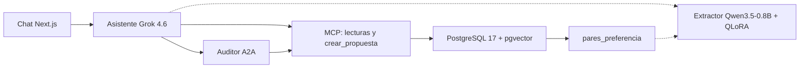

# Relevo

Agente conversacional para coordinar turnos y ausencias en una pyme colombiana
con horarios rotativos. Entiende español coloquial, consulta el Código
Sustantivo del Trabajo con citas, y **solo escribe en la nómina cuando una
persona aprueba una tarjeta**. Lo que muestra la tarjeta es lo que se escribe.
Cada decisión queda como par de preferencia para afinar un extractor propio.

Proyecto final de **SI7016 — Procesamiento del Lenguaje Natural Aplicado**
(Universidad EAFIT, Maestría en Ciencias de Datos y Analítica, 2026-2).
Informe, presentación y guion: [`informe/`](informe/).

**Equipo:** Isabel Jurado Jaramillo · Alejandro Silva Zuluaga · David Botero Londoño

Licencia: [MIT](LICENSE).

## Resultados que ya están medidos

| Resultado | Cifra | De dónde sale |
|---|---|---|
| Exactitud total del extractor, test n = 65 | 3,08 % Qwen3.5-0.8B base → 76,92 % QLoRA v1 | [`docs/orca/reports/C3_LORA_REPORT.md`](docs/orca/reports/C3_LORA_REPORT.md) |
| Misma tabla contra Grok | No se corrió: no había `XAI_API_KEY` | C3 |
| Nómina sintética, semilla 42 | 40 empleados, 1 837 asignaciones, 30 ausencias, 0 solapes | [`docs/orca/reports/A2_DB_REPORT.md`](docs/orca/reports/A2_DB_REPORT.md) |
| Corpus descargado | 20 documentos | [`docs/orca/reports/A3_CORPUS_REPORT.md`](docs/orca/reports/A3_CORPUS_REPORT.md) |
| Corpus insertado en B2 | 18 documentos, 497 chunks | [`docs/orca/reports/B2_INTEGRACION_REPORT.md`](docs/orca/reports/B2_INTEGRACION_REPORT.md) |
| «Recargo nocturno», híbrido, k = 8 | art. 169, art. 168, art. 161 en 322 ms | [`docs/orca/reports/C1_CHAT_RAG_REPORT.md`](docs/orca/reports/C1_CHAT_RAG_REPORT.md) |
| Auditor, 10 trampas | El veredicto obtenido coincide con el caso | [`docs/orca/reports/D2_AUDITOR_REPORT.md`](docs/orca/reports/D2_AUDITOR_REPORT.md) |
| Traza | Span `relevo.turno` en Phoenix, status OK | [`docs/orca/reports/E1_OBSERVABILIDAD_REPORT.md`](docs/orca/reports/E1_OBSERVABILIDAD_REPORT.md) |
| Delta DPO v1 → v2 | Pendiente: no hay reporte E2 en este árbol | [E2: tabla con intervalos] |
| Pruebas con usuarios | Pendiente de sesiones | [F1: sesiones] |

El detalle y las advertencias (qué es simulado, qué falta) están en
[`informe/INFORME_FINAL.md`](informe/INFORME_FINAL.md).

## Arquitectura



`ejecutar_propuesta` no es una tool del modelo: la llama el backend cuando la
tarjeta se aprueba o se corrige. Diagramas y contratos:
[`docs/ARQUITECTURA.md`](docs/ARQUITECTURA.md). Entrega de la semana 2:
[`docs/entrega/S2_arquitectura.html`](docs/entrega/S2_arquitectura.html).
Informe y presentación de la semana 5:
[`docs/entrega/S5_informe.html`](docs/entrega/S5_informe.html),
[`docs/entrega/S5_presentacion.html`](docs/entrega/S5_presentacion.html).

## Cómo correrlo de cero

**Requisitos:** Node 24 o superior, Python 3.11 (el venv de `npm test` lo
necesita: `ml/` importa `datetime.UTC`), Docker.

La base de desarrollo de este equipo ya puede estar en el puerto 5432. Si lo
está, no la apaguen ni la re-siembren: usen ese `localhost:5432`. Los pasos 2,
5, 6 y 7 son para una base vacía.

1. Clona el repositorio y entra en la carpeta.
2. Copia [`.env.example`](.env.example) a `.env`. Rellena `XAI_API_KEY` si vas
   a usar Grok. Sin esa variable el chat responde el stream simulado y lo dice.
   Los valores de `DATABASE_URL` del ejemplo son credenciales locales de
   desarrollo, no un secreto de producción. No subas `.env`.
3. PostgreSQL + pgvector, solo si el puerto 5432 está libre:
   `docker compose up -d db`
4. Phoenix (no depende de la base; se puede levantar aparte):
   `docker compose up -d phoenix`
   Interfaz en `http://localhost:6006`. El backend exporta OTLP **protobuf** a
   `http://localhost:6006/v1/traces`. Esta imagen de Phoenix responde 415 al
   OTLP en JSON.
5. Venv de gates, Python 3.11:
   `py -3.11 -m venv .venv`
   - Windows: `.venv\Scripts\activate` y `pip install -r requirements-dev.txt`
   - macOS/Linux: `source .venv/bin/activate` y el mismo `pip`
6. Migraciones: `python db/migrate.py`
7. Nómina sintética (Faker `es_CO`, semilla 42) y seed:
   `python data/generar_dataset.py`
   `python db/seed.py`
   Si las tablas ya tienen filas, `python db/seed.py` se niega. `--reseed`
   reemplaza la nómina y no toca el corpus. No lo uses sobre una base
   compartida.
8. Dependencias Node: `npm ci`
9. Venv de ML **fuera del clone** (torch dentro del repo hace que ESLint y
   `next build` recorran sus archivos). Desde la raíz:

   ```text
   py -3.11 -m venv ../relevo-ml-venv
   ..\relevo-ml-venv\Scripts\pip install -r ml/requirements.txt
   ..\relevo-ml-venv\Scripts\python ml/indexar.py --solo-descarga
   ..\relevo-ml-venv\Scripts\python ml/indexar.py --desde-cache
   ```

   En macOS/Linux, `../relevo-ml-venv/bin/pip` y `bin/python`.
   `--desde-cache` **sin** `--limit`: un límite grabaría hashes con chunks
   parciales. Si `corpus/raw/` ya existe, puedes omitir `--solo-descarga`.
   `corpus/raw/` no se versiona.
10. Servicio de embeddings (otra terminal, mismo venv de ML):
    `npm run embed:dev`
    Salud: `GET http://127.0.0.1:8631/salud` → `{"ok":true}`.
    La primera carga de bge-m3 en CPU supera el tope de 3 s y esa consulta
    degrada a léxico. `POST /rerank` responde 501 si
    `BAAI/bge-reranker-v2-m3` no está en la caché de Hugging Face; la búsqueda
    sigue con los scores de RRF.
11. Auditor A2A (otra terminal): `npm run auditor:dev`
    Escucha en `AUDITOR_PORT` (8641). Tarjeta:
    `GET http://127.0.0.1:8641/.well-known/agent.json`.
12. Chat: `npm run dev` y abre `http://localhost:3000`.
    El selector trae Coordinadora de enfermería, Jefe de vigilancia y Gerencia.
    El servidor MCP por stdio, si lo quieres aparte del chat, es `npm run mcp`.

El extractor afinado como servicio HTTP (`EXTRACTOR_URL`, `npm run extractor:dev`)
es el entregable de la ola E2 y **no está en este árbol**. Con `EXTRACTOR_URL`
vacío, la extracción la hace Grok. Si el servicio existe y falla, también cae
a Grok.

Variables documentadas en [`.env.example`](.env.example): `DATABASE_URL`,
`PGPORT`, `XAI_API_KEY`, `RELEVO_MODELO`, `EMBED_SERVICE_URL`, `AUDITOR_URL`,
`AUDITOR_PORT`, `AUDITOR_TIMEOUT_MS`, `EXTRACTOR_URL`,
`PHOENIX_COLLECTOR_ENDPOINT`, `OTEL_SERVICE_NAME`.

## Cómo reproducir cada evaluación

Con la base activa y, para el extractor, el venv de GPU que usó C3
(`../relevo-gpu-venv`: torch con CUDA, `peft`, `trl`, `bitsandbytes`). Los
pesos `ml/models/` y las corridas `ml/runs/` no se versionan.

| Qué | Comando que existe hoy | Qué falta |
|---|---|---|
| Gates | `npm run lint`, `npm test`, `npm run build` | — |
| Extracción base y v1 | `ml/evaluar_extraccion.py --proveedor base` y `--proveedor lora --adapter ml/models/extractor-v1` | Intervalo, columna Grok y v2: [F1: `npm run eval:extraccion`] [E2: `ml/comparar_versiones.py`] |
| Citas | El humo de `buscar_norma` está descrito en el reporte C1 | [F1: `evaluacion/evaluar_citas.ts`] |
| Auditor | `npm test` incluye `tests/auditor/escenarios.test.ts` (10 escenarios, base real) | [F1: 10 trampas extra y matriz 3×3] |
| Aprobaciones | SQL del anexo A de [`informe/INFORME_FINAL.md`](informe/INFORME_FINAL.md) | [F1: `npm run eval:aprobaciones`] |
| Usuarios | — | [F1: protocolo y sesiones] |

Entrenar v1 de nuevo (misma línea que C3, 4 635 s en la 4060 de ese reporte):

```text
..\relevo-gpu-venv\Scripts\python.exe ml\entrenar_lora.py --epocas 3 --lr 0.0002 --r 16 --batch 1 --grad-acum 8 --salida ml\models\extractor-v1
```

## Estructura

| Ruta | Qué hay |
|---|---|
| `app/`, `components/`, `lib/` | Chat Next.js 15, agente, guardrails, memoria, cliente A2A |
| `mcp/` | Tools MCP |
| `auditor/` | Servicio A2A y reglas (44 h, domingos, solapes) |
| `db/` | Migraciones SQL, runner y seed |
| `data/` | Nómina sintética y órdenes (`train` / `val` / `test`) |
| `ml/` | Indexación bge-m3, `servir.py`, extractor QLoRA |
| `corpus/` | `fuentes.json` (`raw/` no se versiona) |
| `informe/` | Informe final, presentación, guion de demo |
| `docs/` | Arquitectura, plan, fuentes del curso, specs y reportes |
| `docker-compose.yml` | PostgreSQL 17 + pgvector, y Phoenix |

## Estado por semana

| Semana | Qué quedó |
|---|---|
| S1 | Propuesta: `docs/fuentes/Propuesta_Relevo_NLP_v2.docx` |
| S2 | Arquitectura, esqueleto, esquema, corpus, MCP de lectura, gates |
| S3 | Grok, RAG híbrido con citas, QLoRA v1 (3,08 % → 76,92 %) |
| S4 | Tarjeta, auditor A2A, trazas en Phoenix, perfiles y guardrails |
| S5 | Este informe, la presentación y el guion. Evaluación consolidada y DPO v2: pendientes de las olas F1 y E2 |

Plan: [`docs/PLAN_DESARROLLO.md`](docs/PLAN_DESARROLLO.md). Tope de entrega del curso: 30 de septiembre de 2026.

## Demo

[`informe/GUION_DEMO.md`](informe/GUION_DEMO.md). Ocho minutos, con checklist de diez puntos y un plan B si xAI no responde.

## Reglas duras

1. **Datos sintéticos.** Empleados, turnos, ausencias y órdenes son ficticios (Faker `es_CO`, semilla 42). Nada de datos reales ni de terceros.
2. **Escribir exige aprobación.** Ninguna ruta escribe en `empleados`, `asignaciones` o `ausencias` sin una propuesta aprobada en una tarjeta.
3. **Secretos solo en `.env`.** Nunca en el repo, en logs, en tests ni en reportes.
