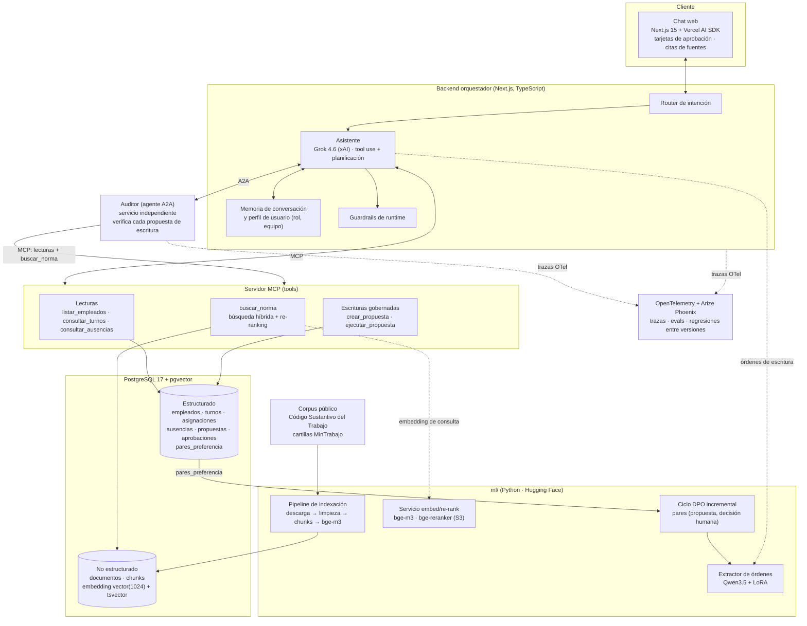
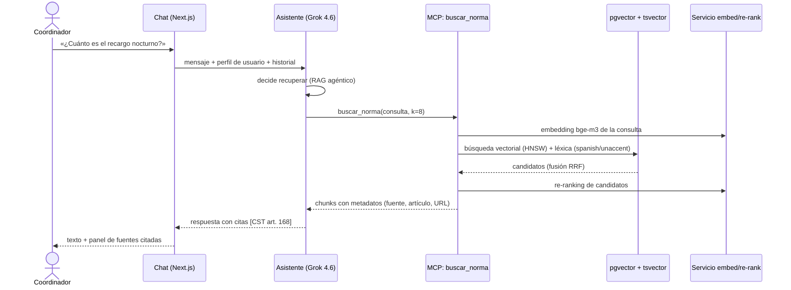
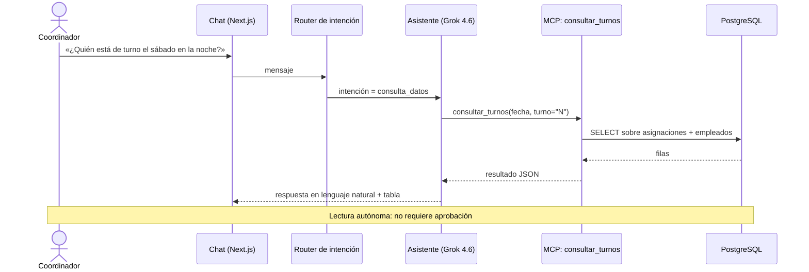
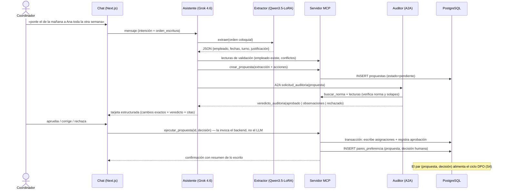

# Relevo — Arquitectura del agente y componentes inteligentes de backend

**SI7016 Procesamiento del Lenguaje Natural Aplicado · Universidad EAFIT · 2026-2 · Entrega semana 2**
Equipo: Isabel Jurado Jaramillo · Alejandro Silva Zuluaga · David Botero Londoño

---

## 1. Resumen

Relevo es un agente conversacional para coordinadores de turnos de pymes
colombianas con horarios rotativos. Su principio de diseño gobierna toda la
arquitectura: **consultar es autónomo; escribir exige la aprobación de una
persona**. El agente entiende órdenes en español coloquial colombiano, consulta
la norma laboral vigente (RAG con citas), propone cada cambio en una tarjeta
estructurada verificada por un segundo agente auditor, y solo escribe en la base
cuando el usuario aprueba. Cada decisión humana (aprobar, corregir, rechazar) se
captura como par de preferencia para un ciclo de ajuste incremental DPO/LoRA del
extractor de órdenes — la innovación del proyecto: la aprobación humana como dato
de entrenamiento.

## 2. Diagrama de componentes



Notas de lectura del diagrama:

- El **asistente** es el único que conversa con el usuario; el **auditor** es un
  servicio separado que se comunica solo por A2A y tiene sus propias credenciales
  MCP de **solo lectura**.
- `ejecutar_propuesta` es la única ruta de escritura sobre nómina y **no está
  expuesta al LLM**: la invoca el backend cuando el usuario aprueba la tarjeta.
- El extractor afinado reemplaza gradualmente a Grok en la sub-tarea de
  extracción (orden coloquial → JSON); Grok sigue siendo el cerebro conversacional.

## 3. Flujos de interacción

### 3.1 Consulta normativa (RAG agéntico con citas)



### 3.2 Consulta de datos estructurados (tool de lectura)



### 3.3 Escritura con aprobación humana (el camino completo)



## 4. Integración con herramientas externas

### 4.1 Contratos de las tools MCP

Todas las tools se exponen en un **servidor MCP** propio (`mcp/`, SDK oficial de
TypeScript, transporte stdio para desarrollo y HTTP streamable para despliegue).
Entradas y salidas validadas con Zod. `s` = disponible desde esa semana.

| Tool | Entrada | Salida | Tipo | ¿Aprobación humana? | s |
|---|---|---|---|---|---|
| `listar_empleados` | `{equipo?, activo?}` | lista de empleados (id, nombre, rol, equipo) | lectura | no | S2 |
| `consultar_turnos` | `{empleado?, desde, hasta, turno?}` | asignaciones con empleado, turno y fecha | lectura | no | S2 |
| `consultar_ausencias` | `{empleado?, desde, hasta, tipo?}` | ausencias con tipo, rango y estado | lectura | no | S2 |
| `buscar_norma` | `{consulta, k=8}` | chunks con texto y metadatos (fuente, artículo, URL, score) | lectura (RAG) | no | S2 léxica · S3 híbrida |
| `crear_propuesta` | `{orden_texto, extraccion, acciones[]}` | `{propuesta_id, estado: "pendiente"}` | escritura de **propuesta** (no toca nómina) | no (la exige después) | S3 |
| `ejecutar_propuesta` | `{propuesta_id, decision, correccion?}` | resumen de filas escritas | **escritura de nómina** | **sí — solo backend tras tarjeta aprobada; nunca expuesta al LLM** | S3 |
| `consultar_perfil` | `{usuario}` | rol, equipo, preferencias | lectura (memoria) | no | S4 |

Invariantes de seguridad de las tools:

1. La conexión del asistente y del auditor a PostgreSQL usa un rol **de solo
   lectura**; únicamente `ejecutar_propuesta` (backend) usa el rol de escritura.
2. `ejecutar_propuesta` escribe **exactamente** las `acciones[]` congeladas en la
   propuesta que mostró la tarjeta — no re-interpreta la orden.
3. Toda escritura queda en una transacción con registro en `aprobaciones` y
   generación del par de preferencia.

### 4.2 Mensajes A2A (asistente ↔ auditor)

El auditor es un servicio independiente que publica su **Agent Card** y recibe
tareas por el protocolo A2A (JSON-RPC sobre HTTP). Dos mensajes:

**`solicitud_auditoria`** (asistente → auditor):

```json
{
  "propuesta_id": "uuid",
  "orden_texto": "ponle el de la mañana a Ana toda la otra semana",
  "extraccion": {
    "empleado": "Ana María Rojas",
    "turno": "M",
    "fechas": ["2026-09-07", "…", "2026-09-13"],
    "justificacion": null
  },
  "acciones": [
    { "tipo": "asignar_turno", "empleado_id": 12, "turno": "M", "fecha": "2026-09-07" }
  ],
  "contexto": { "solapes_detectados": [], "ausencias_en_rango": [] }
}
```

**`veredicto_auditoria`** (auditor → asistente):

```json
{
  "propuesta_id": "uuid",
  "veredicto": "aprobado | observaciones | rechazado",
  "razones": ["El 2026-09-13 es domingo: aplica recargo dominical"],
  "normas_citadas": [{ "fuente": "CST", "articulo": "179", "chunk_id": 481 }],
  "verificaciones": {
    "empleado_existe": true,
    "sin_solapes": true,
    "jornada_dentro_de_limites": true
  }
}
```

El auditor verifica de forma independiente (con sus propias llamadas MCP de
lectura): que el empleado exista y esté activo, que no haya solapes con
asignaciones o ausencias, que la jornada resultante respete los límites legales,
y qué recargos aplican según la norma recuperada. Un veredicto `rechazado`
bloquea la tarjeta; las `observaciones` se muestran en la tarjeta para que el
humano decida informado.

### 4.3 Componentes inteligentes de backend

| Componente | Qué hace | Cómo |
|---|---|---|
| **Router de intención** | Clasifica cada mensaje: `consulta_norma`, `consulta_datos`, `orden_escritura`, `charla` | S3: clasificación por el propio Grok con salida estructurada; candidato a moverse al modelo afinado |
| **Extractor afinado** | Orden coloquial colombiana → JSON `{empleado, fechas, turno, justificación}`; resuelve fechas relativas («la otra semana», «el puente») | Qwen3.5 + LoRA (HF), entrenado con MASSIVE es-ES + dataset sintético propio validado a mano; se compara contra Grok en la misma tarea |
| **Recuperador híbrido + re-ranker** | Recupera la norma laboral relevante | pgvector HNSW (bge-m3, coseno) + `tsvector` español con unaccent, fusión RRF, re-ranking con bge-reranker-v2-m3; el asistente decide cuándo llamar (RAG agéntico) |
| **Auditor** | Segunda opinión automática sobre cada propuesta de escritura | Agente A2A independiente con LLM propio + verificaciones deterministas (SQL) |
| **Memoria y perfil** | Historial por conversación; rol y equipo del usuario condicionan respuestas y alcance de datos | Tablas `conversaciones`/`mensajes` + `perfiles`; inyección en el system prompt |
| **Guardrails** | Nunca escribir sin tarjeta aprobada; citas obligatorias en respuestas normativas; sin datos personales reales; límites de alcance por rol | Reglas deterministas en el backend + evals continuos en Phoenix (fidelidad de citas, detección de alucinación) |

## 5. Tecnologías elegidas y por qué

| Capa | Tecnología | Por qué |
|---|---|---|
| UI | **Next.js 15 + Vercel AI SDK** | Streaming de chat y tool-calls resuelto; tarjetas como componentes React; despliegue directo en Vercel |
| LLM de frontera | **Grok 4.6 (xAI)** vía `@ai-sdk/xai` | Frontera en razonamiento y tool use; es el «rival a vencer» del experimento DPO |
| Extractor | **Qwen3.5 + LoRA (Hugging Face)** | Open-weight afinable en GPU modesta; los datos no salen de la organización |
| Embeddings | **bge-m3** (1024 d) | Multilingüe fuerte en español, open-source, denso + léxico, corre en CPU |
| Base de datos | **PostgreSQL 17 + pgvector** | Un solo motor para lo estructurado y lo vectorial; HNSW + `tsvector` habilitan búsqueda híbrida sin infraestructura extra |
| Tools | **MCP (SDK TypeScript)** | Protocolo abierto exigido por el curso; separa el contrato de herramientas del orquestador |
| Inter-agente | **A2A** | Protocolo abierto para asistente↔auditor; demuestra interoperabilidad multi-proveedor |
| Fine-tuning | **LoRA / DPO (peft, trl)** | Ajuste incremental barato sin reentrenar desde cero |
| Observabilidad | **OpenTelemetry + Arize Phoenix** | Trazas de cada tool-call, evals automáticos y comparación entre versiones del extractor |
| Datos sintéticos | **Faker es_CO** (semilla fija) | Nómina colombiana verosímil, reproducible y sin datos reales |
| Acceso a datos | SQL explícito (`postgres-js` en TS, `psycopg` en Python) | Menos capas; las tools MCP son consultas auditables |

### Riesgos y alternativas

| Riesgo | Impacto | Mitigación / alternativa |
|---|---|---|
| URLs públicas del corpus cambian o caen | Indexación no reproducible | Copia local en `corpus/raw/` con hash y fecha; `corpus/fuentes.json` versionado; fuentes espejo (Senado, SUIN-Juriscol, Función Pública) |
| Reforma laboral (Ley 2101/2021, Ley 2466/2025) cambia jornadas y recargos | Respuestas normativas desactualizadas | Metadato `vigencia` por chunk; priorizar texto consolidado vigente; eval de fidelidad de citas |
| bge-m3 lento en CPU para indexar/consultar | Latencia | Indexación por lotes con caché; servicio embed persistente (S3); si no alcanza, API de embeddings como plan B documentado |
| GPU limitada para LoRA/DPO | No se puede entrenar | QLoRA 4-bit sobre un Qwen3.5 pequeño (4B); Colab/Lightning como respaldo; el ciclo DPO es demostrativo, no productivo |
| Cuota/costo de la API de Grok | Demo interrumpida | El router degrada a extractor local + respuestas RAG; caché de respuestas en evaluación |
| A2A añade complejidad de red | Retraso en S4 | El auditor se desarrolla primero como módulo en proceso con el mismo contrato JSON; A2A envuelve ese contrato |
| Pocas decisiones humanas para DPO | Señal de preferencia débil | Sesiones de anotación con el equipo + escenarios simulados; resultados con intervalos, no solo promedios |

## 6. Esquema de datos (PostgreSQL)

Convención: identificadores en español, `snake_case`. Extensiones: `vector`,
`unaccent`. Migraciones SQL planas en `db/migrations/`.

```sql
-- Catálogo de turnos (M = mañana, T = tarde, N = noche)
turnos(id PK, codigo CHAR(1) UNIQUE, nombre, hora_inicio TIME, hora_fin TIME,
       cruza_medianoche BOOL)

empleados(id PK, nombre, documento UNIQUE,       -- sintético (Faker es_CO)
          rol, equipo, fecha_ingreso DATE, activo BOOL)

asignaciones(id PK, empleado_id FK→empleados, turno_id FK→turnos, fecha DATE,
             estado CHECK IN ('programada','completada','cancelada'),
             origen CHECK IN ('seed','tarjeta'), propuesta_id FK NULL,
             creado_en TIMESTAMPTZ,
             UNIQUE (empleado_id, fecha, turno_id))

ausencias(id PK, empleado_id FK, tipo CHECK IN
          ('vacaciones','incapacidad','permiso','licencia'),
          fecha_inicio DATE, fecha_fin DATE,
          estado CHECK IN ('aprobada','pendiente','rechazada'), motivo,
          propuesta_id FK NULL, creado_en TIMESTAMPTZ)

-- La tarjeta: qué propuso el agente y qué decidió el humano
propuestas(id UUID PK, conversacion_id FK NULL, usuario, orden_texto,
           extraccion JSONB,          -- salida del extractor
           acciones JSONB,            -- acciones exactas que mostrará la tarjeta
           veredicto_auditor JSONB,   -- veredicto_auditoria completo
           estado CHECK IN ('pendiente','aprobada','corregida','rechazada','expirada'),
           creado_en, decidido_en TIMESTAMPTZ)

aprobaciones(id PK, propuesta_id FK→propuestas, usuario,
             decision CHECK IN ('aprobar','corregir','rechazar'),
             correccion JSONB NULL,   -- acciones corregidas por el humano
             creado_en TIMESTAMPTZ)

-- Señal de entrenamiento del ciclo DPO
pares_preferencia(id PK, propuesta_id FK, prompt_texto,
                  elegida JSONB,      -- extracción correcta (aprobada/corregida)
                  rechazada JSONB,    -- extracción original si fue corregida/rechazada
                  origen CHECK IN ('aprobacion','correccion','rechazo'),
                  usado_en_version TEXT NULL, creado_en TIMESTAMPTZ)

-- Memoria y perfil
perfiles(usuario PK, rol, equipo, preferencias JSONB)
conversaciones(id UUID PK, usuario, iniciado_en TIMESTAMPTZ)
mensajes(id PK, conversacion_id FK, rol CHECK IN ('user','assistant','tool'),
         contenido JSONB, creado_en TIMESTAMPTZ)

-- Corpus normativo (no estructurado)
documentos(id PK, titulo, fuente, tipo CHECK IN ('ley','decreto','cartilla'),
           url, fecha_descarga DATE, hash_sha256, vigencia TEXT)
chunks(id PK, documento_id FK→documentos, ref TEXT,   -- p. ej. «art. 168»
       texto, metadatos JSONB,
       embedding vector(1024),                        -- bge-m3
       tsv tsvector GENERATED STORED)                 -- spanish + unaccent inmutable
-- Índices: HNSW (embedding vector_cosine_ops) · GIN (tsv)
```

Roles de base de datos: `relevo_lector` (SELECT; lo usan las tools de lectura y
el auditor) y `relevo_escritor` (INSERT/UPDATE; solo `crear_propuesta`,
`ejecutar_propuesta` y el pipeline de indexación).

### Dataset sintético

Generado por `data/generar_dataset.py` (Faker `es_CO`, semilla fija = 42):
~40 empleados en 3 equipos (una clínica simulada: enfermería, recepción,
vigilancia), 8 semanas de asignaciones con rotación realista M→T→N, descanso
dominical alternado y ~30 ausencias mezcladas. Validaciones del generador: sin
solapes, sin turnos durante ausencias aprobadas, límites de jornada semanal.

## 7. Estrategia del corpus normativo

| Fuente | Tipo | Formato | Qué aporta |
|---|---|---|---|
| Código Sustantivo del Trabajo (texto consolidado, Secretaría del Senado / SUIN-Juriscol) | ley | HTML | Jornada (arts. 158–167), horas extras y recargos (168–170), descansos (172–178), dominicales y festivos (179–185), trabajo nocturno |
| Cartillas del Ministerio del Trabajo (jornada laboral, trabajo suplementario, descansos) | cartilla | PDF | Interpretación oficial en lenguaje llano, ejemplos numéricos |
| Ley 2101 de 2021 (reducción de jornada) y Ley 2466 de 2025 (reforma laboral) | ley | HTML/PDF | Vigencias actuales de jornada máxima y recargos |

**Pipeline** (`ml/indexar.py`): descarga (copia en `corpus/raw/` con hash y
fecha, fuera del repo) → limpieza → **chunking estructural**: leyes por artículo
(un chunk = un artículo, con capítulo y título como contexto), cartillas por
sección de ~500–800 tokens con solape de 100 → metadatos (`fuente`, `tipo`,
`ref`, `url`, `vigencia`) → embeddings bge-m3 normalizados por lotes → upsert en
`chunks`. Reindexación idempotente por hash de documento. La consulta usa
búsqueda híbrida (§4.3) y la UI muestra siempre la cita (`fuente`, `ref`, URL).

## 8. Observabilidad, evaluación y guardrails

- **Trazas**: OpenTelemetry en backend, MCP y auditor → Arize Phoenix. Cada
  conversación es una traza; cada tool-call y cada veredicto A2A, un span.
- **Evals automáticos** (S3–S5): exactitud de extracción por campo (afinado vs.
  Grok, mismo set de órdenes), fidelidad de citas (juez LLM sobre respuesta vs.
  chunks citados), tasa de aprobación humana de tarjetas, regresiones entre
  versiones LoRA/DPO (antes/después con el mismo eval set).
- **Guardrails**: escritura imposible sin propuesta aprobada (invariante de
  código y de rol de BD), citas obligatorias en respuestas normativas, datos
  100 % sintéticos, secretos solo en `.env`.

## 9. Estructura del repositorio

```
app/ components/ lib/   # Chat Next.js 15 + AI SDK (TypeScript)
mcp/                    # Servidor MCP (tools) — ola B
db/                     # Migraciones SQL + runner y seed (psycopg)
data/                   # Generador del dataset sintético
ml/                     # Indexación bge-m3; luego LoRA/DPO
corpus/                 # fuentes.json (raw/ no se versiona)
docs/                   # Este documento, plan, fuentes del curso, specs (docs/orca/)
docker-compose.yml      # PostgreSQL + pgvector local
```

Gates de calidad en cada cambio: `npm run lint`, `npm test`, `npm run build`
(incluyen ruff y pytest para la parte Python). Merge a `main` solo tras
auditoría del orquestador con gates verdes.
