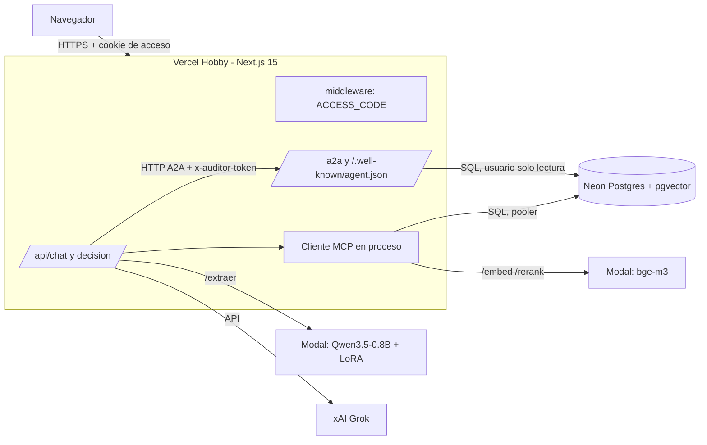

# Despliegue en la nube: Vercel, Neon y Modal

Relevo corre en local con Docker, pero la demo final se sirve desde la nube con
las mismas capacidades: chat, MCP, auditor A2A, recuperación híbrida y extractor
afinado. Todo lo nuevo se activa con variables de entorno; sin ellas, el modo
local queda exactamente igual.

## Arquitectura



- **Vercel**: la app Next.js. El auditor A2A son rutas de la misma app
  (`/a2a`, `/.well-known/agent.json`); el asistente lo llama por HTTP a través
  de `AUDITOR_URL=https://<app>.vercel.app`, de modo que el protocolo viaja por
  internet. Las rutas de chat y decisión admiten hasta 120 s (`maxDuration`).
- **Neon**: PostgreSQL con pgvector. Se usa la URL del *pooler* (modo
  transacción). El cliente detecta `neon.tech` y usa `prepare: false`, pool de
  1 conexión, `ssl: require` e idle corto.
- **Modal**: servicios de modelos (embeddings, re-ranking, extractor). Se
  despliegan aparte (`deploy/modal/`); la web solo conoce sus URL.

### Escritura sigue exigiendo aprobación

El único camino a las tablas de nómina sigue siendo `ejecutar_propuesta`, dentro
de `sql.begin` con `SET LOCAL ROLE relevo_escritor`. `SET LOCAL` vale solo para
la transacción, así que es seguro detrás del pooler en modo transacción.

El auditor antes hacía un `SET ROLE relevo_lector` de **sesión** sobre una
conexión reservada. Eso no es fiable con el pooler de Neon (cada transacción
puede caer en otro backend), así que en modo serverless el auditor omite ese
`SET ROLE` y el aislamiento lo da el usuario de la conexión: define
`AUDITOR_DATABASE_URL` con un usuario de login cuyo rol sea de solo lectura
(`relevo_lector` con `LOGIN`). Si no se define, usa `DATABASE_URL`.

## Variables de entorno

Los valores marcados **SECRETO** solo viven en Vercel (y en `.env` local si se
prueba); nunca en el repo, en logs ni en capturas.

### Vercel (producción)

| Variable | Valor | Secreto |
| --- | --- | --- |
| `DATABASE_URL` | URL del pooler de Neon (`...-pooler...neon.tech/...?sslmode=require`) | **SECRETO** |
| `AUDITOR_DATABASE_URL` | URL del pooler con el usuario de solo lectura | **SECRETO** |
| `XAI_API_KEY` | clave de xAI | **SECRETO** |
| `ACCESS_CODE` | código de acceso de la demo | **SECRETO** |
| `AUDITOR_TOKEN` | cadena aleatoria larga | **SECRETO** |
| `AUDITOR_URL` | `https://<app>.vercel.app` | no |
| `AUDITOR_PUBLIC_URL` | `https://<app>.vercel.app` (opcional) | no |
| `EMBED_SERVICE_URL` | URL base del servicio Modal de embeddings | no |
| `EXTRACTOR_URL` | URL base del servicio Modal del extractor | no |
| `DB_SERVERLESS` | `1` (opcional; con host `neon.tech` ya se activa) | no |
| `DB_POOL_MAX` | `1` (opcional) | no |
| `RELEVO_MODELO` | `grok-4.7` (opcional) | no |
| `AUDITOR_TIMEOUT_MS` | `15000` recomendado en la nube (arranque en frío) | no |
| `PHOENIX_COLLECTOR_ENDPOINT` | **no definir**: sin él, OTel queda en silencio | no |

Si los endpoints de Modal exigen token, ese secreto lo gestiona la tarea de
Modal; la web no usa `MODAL_TOKEN_*`.

### Modal y Neon

Los tokens de Modal y las credenciales de Neon se configuran en sus paneles o
CLI; no pasan por la web.

## Pasos (los ejecuta el orquestador)

Todos desde la raíz del repo. Los valores se leen por stdin para no quedar en el
historial de la terminal ni en pantalla.

```bash
# 1. Enlazar el proyecto (una vez)
npx vercel link

# 2. Variables. Cada comando pide el valor por stdin, sin eco.
#    Secretos:
read -rs V && printf '%s' "$V" | npx vercel env add DATABASE_URL production
read -rs V && printf '%s' "$V" | npx vercel env add AUDITOR_DATABASE_URL production
read -rs V && printf '%s' "$V" | npx vercel env add XAI_API_KEY production
read -rs V && printf '%s' "$V" | npx vercel env add ACCESS_CODE production
read -rs V && printf '%s' "$V" | npx vercel env add AUDITOR_TOKEN production
#    No secretas:
printf '%s' "https://<app>.vercel.app" | npx vercel env add AUDITOR_URL production
printf '%s' "https://<servicio-embed>.modal.run" | npx vercel env add EMBED_SERVICE_URL production
printf '%s' "https://<servicio-extractor>.modal.run" | npx vercel env add EXTRACTOR_URL production
printf '%s' "15000" | npx vercel env add AUDITOR_TIMEOUT_MS production
unset V

# 3. Despliegue
npx vercel deploy --prod
```

Primera vez: la URL de la app no se conoce hasta el primer despliegue. Despliega,
anota la URL, define `AUDITOR_URL` y vuelve a desplegar.

### Comprobación rápida

```bash
curl -si https://<app>.vercel.app/ | head -3          # 307 hacia /acceso
curl -s  https://<app>.vercel.app/api/chat -X POST     # 401 sin cookie
curl -s -H "x-auditor-token: $AUDITOR_TOKEN" \
  https://<app>.vercel.app/.well-known/agent.json      # Agent Card
```

## Código de acceso

La cookie `relevo_acceso` guarda un HMAC-SHA256 del código (nunca el código),
con `httpOnly`, `secure`, `sameSite=lax` y 7 días de vigencia. La comparación es
de tiempo constante. `/acceso`, `/api/acceso`, `/a2a` y
`/.well-known/agent.json` quedan fuera de la compuerta; las dos últimas se
protegen con `AUDITOR_TOKEN`.

### Rotar el código

```bash
npx vercel env rm ACCESS_CODE production
read -rs V && printf '%s' "$V" | npx vercel env add ACCESS_CODE production; unset V
npx vercel deploy --prod
```

Como la cookie depende del código, cambiarlo invalida todas las sesiones
abiertas. Para rotar `AUDITOR_TOKEN` se hace lo mismo; no hay sesiones que
cerrar porque solo lo usa el servidor.

## Local

Sin `ACCESS_CODE`, `AUDITOR_TOKEN`, `DB_SERVERLESS` ni URL de Neon, el
middleware no hace nada, el cliente de BD usa su pool de 8 con sentencias
preparadas y `npm run auditor:dev` sigue sirviendo el auditor en el puerto 8641.
