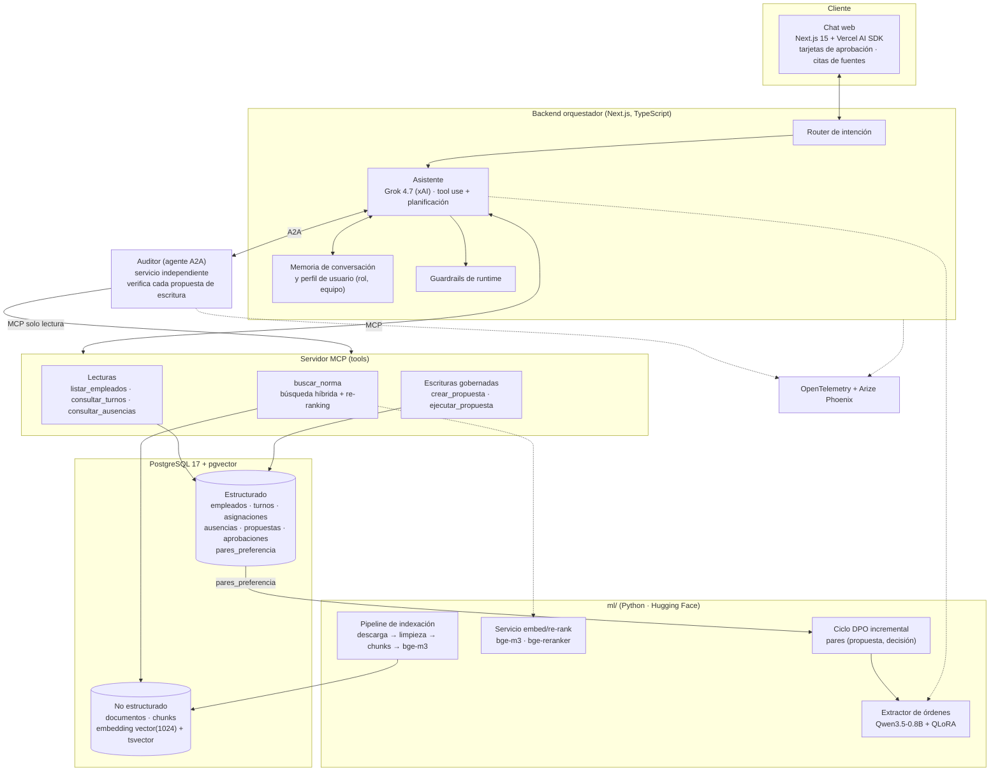

# Relevo — Informe técnico final

**SI7016 Procesamiento del Lenguaje Natural Aplicado · Universidad EAFIT · 2026-2**
Maestría en Ciencias de Datos y Analítica. Entrega semana 5 (tope: 30 de septiembre de 2026).

Equipo: Isabel Jurado Jaramillo · Alejandro Silva Zuluaga · David Botero Londoño

Relevo es un agente conversacional para coordinar turnos y ausencias en una pyme colombiana simulada. Consultar es autónomo. Escribir en la nómina exige que una persona apruebe una tarjeta, y esa decisión queda como dato para afinar el extractor.

Este informe cita cada cifra. Las tablas de resultados apuntan al reporte de la ola (`docs/orca/reports/`), al JSON de `evaluacion/resultados/` o, cuando el número no está en un reporte, a la consulta de solo lectura que lo produjo. Las cifras de E2 y de F1 salen de esos reportes. Las cifras de Grok 4.7 salen de `evaluacion/extraccion.md` y las del juez de citas de `evaluacion/citas.md`, con sus JSON en `evaluacion/resultados/` y los commits `82cc2c1` y `e5385fe`. Donde faltan sesiones con personas, el texto dice pendiente. No hay cifras de relleno.

## Mapa de la rúbrica

La rúbrica del curso (`docs/fuentes/SI7016-ProyectoFinal-2026-2.pdf`, página 4) califica cada criterio de 1 a 5 y pondera así. La nota no se calcula aquí: la tabla dice dónde está la evidencia.

| Criterio | Peso | Qué pide el curso | Dónde está la evidencia |
|---|---:|---|---|
| Originalidad e innovación | 15 % | Creatividad y un componente de futuro del NLP (horizonte 1–5 años) | §7. Pregunta prospectiva de la propuesta (`docs/fuentes/Propuesta_Relevo_NLP_v2.docx`) |
| Calidad técnica | 25 % | NLP, LLMs, RAG, embeddings y lo visto en clase | §4, §5, §6. Reportes C1, C3, D2 |
| Uso adecuado de tecnologías | 15 % | Frameworks y protocolos (el curso nombra MCP, A2A, Hugging Face, pgvector, Phoenix) | §5, en especial «Uso de protocolos abiertos». `.env.example` |
| Funcionalidad de la aplicación | 20 % | El agente completo, incluida la interfaz | §5.3–§5.6. Guion `informe/GUION_DEMO.md`. Reportes D1, D2, E1 |
| Evaluación y validación | 10 % | Pruebas y análisis del desempeño | §8. C3 (n = 65), D2 (10 escenarios), E1 (traza), E2 (v2) y F1 (`evaluacion/`) |
| Presentación final | 10 % | Claridad de la presentación oral o de la demo | `informe/PRESENTACION.md`, `docs/entrega/S5_presentacion.html`, `informe/GUION_DEMO.md` |
| Informe escrito | 5 % | Claridad y profundidad del documento técnico | Este archivo y `docs/entrega/S5_informe.html` |

## 1. Resumen ejecutivo

Una coordinadora de turnos escribe en español coloquial («ponle el de la mañana a Doris toda la otra semana») y espera dos cosas que un chat genérico no garantiza: que la norma citada sea la del Código Sustantivo del Trabajo, y que el cambio en la nómina sea exactamente el que ella vio antes de aprobarlo.

Relevo separa esas dos responsabilidades. El asistente (Grok 4.7, Vercel AI SDK; la propuesta planteó Grok 4.6 y el modelo pasó a 4.7 al mismo precio, commit `2b15c75`) conversa, enruta la intención y llama tools MCP de lectura y de propuesta. Un auditor independiente, por A2A, revisa cada propuesta con reglas deterministas y cita el artículo que aplica. La única escritura sobre `asignaciones` y `ausencias` ocurre cuando la persona aprueba la tarjeta; el modelo no tiene esa tool. Cada decisión se guarda en `pares_preferencia`.

Lo que ya está medido, y de dónde sale:

| Resultado | Cifra | Fuente |
|---|---|---|
| Exactitud total del extractor, medición C3 (n = 65) | 3,08 % el Qwen3.5-0.8B base; 76,92 % con QLoRA v1 | `docs/orca/reports/C3_LORA_REPORT.md` |
| Comparación contra Grok 4.7 en esa misma tarea (n = 65) | Grok 4.7 98,46 % IC 95 % [95,38 %, 100,00 %] frente a 83,08 % [73,85 %, 90,77 %] de v2. Los intervalos no se solapan | `evaluacion/extraccion.md`, `evaluacion/resultados/extraccion.json`, commit `82cc2c1` |
| Corpus normativo descargado | 20 documentos, 1 743 846 bytes | `docs/orca/reports/A3_CORPUS_REPORT.md` |
| Corpus insertado en la indexación de B2 | 18 documentos, 497 chunks | `docs/orca/reports/B2_INTEGRACION_REPORT.md` |
| Corpus vigente tras el reindexado | 20 documentos, 589 chunks | Commit `a21a6d6`. La foto de B2 (18/497) queda como histórica |
| Nómina sintética (semilla 42) | 3 turnos, 40 empleados, 1 837 asignaciones, 30 ausencias, 0 solapes con ausencias aprobadas | `docs/orca/reports/A2_DB_REPORT.md` |
| Auditor, 10 trampas de D2 | El veredicto obtenido coincide con el caso en los 10 | `docs/orca/reports/D2_AUDITOR_REPORT.md` |
| Auditor, 20 escenarios de F1 | 20/20. Precisión 100 % en aprobado (3), observaciones (9) y rechazado (8). Matriz diagonal | `docs/orca/reports/F1_EVALUACION_REPORT.md`, `evaluacion/resultados/auditor.json` |
| Traza de un turno en Phoenix | Span `relevo.turno`, kind AGENT, status OK | `docs/orca/reports/E1_OBSERVABILIDAD_REPORT.md` |
| Delta DPO v1 → v2, exactitud total (n = 65) | v1 76,92 % IC 95 % [66,15 %, 87,69 %]; v2 83,08 % IC 95 % [73,85 %, 90,77 %]; delta +6,15 pp. Los intervalos se solapan | `docs/orca/reports/E2_DPO_REPORT.md`, `evaluacion/resultados/extraccion.json` |
| Citas, 20 preguntas, modo híbrido | recall@3 97,50 %, recall@5 100 %, recall@8 100 %, MRR 0,933. Fidelidad media 0,926 con juez Grok 4.7 (16 de 20 en 1,000; mínimo 0,500 en c02) | `docs/orca/reports/F1_EVALUACION_REPORT.md` (recuperación), `evaluacion/citas.md`, `evaluacion/resultados/citas.json`, commit `e5385fe` (juez) |
| Aprobación del simulador | 75,83 % sin corrección (91/120). 29 corregidas. Humanos: 0 filas | `evaluacion/resultados/aprobaciones.json` |
| Pruebas con usuarios | Pendiente de sesiones. El protocolo está en `evaluacion/PROTOCOLO_USUARIOS.md` | `docs/orca/reports/F1_EVALUACION_REPORT.md` |

La innovación es el ciclo tarjeta → par → DPO → medición. El ciclo ya corrió con 29 correcciones simuladas (reporte E2): la exactitud total pasa de 76,92 % a 83,08 % y los intervalos se solapan. Con la columna Grok 4.7 ya medida, hoy el modelo de frontera gana con claridad en esta tarea: 98,46 % contra 83,08 %, con intervalos que no se solapan (una brecha de unos 15 pp). La pregunta de 1 a 5 años sigue abierta en lo que falta: más señal de corrección y las sesiones con personas (secciones 7 y 11).

## 2. Introducción y caso de uso

Los asistentes responden bien y actúan mal cuando la acción modifica un sistema real. Programar un turno o registrar una ausencia no puede quedar en manos del modelo sin un control que una persona entienda. Hacerlo a mano, en cambio, anula al agente. Esa tensión está en la propuesta de la semana 1 y gobierna la arquitectura.

El caso es una clínica ficticia con tres equipos y horarios rotativos: enfermería (20 personas), recepción (10) y vigilancia (10). El público es la coordinación de turnos de una pyme, no un perfil técnico. Habla en español de Colombia, con fechas relativas («la otra semana», «el puente», «el finde») y alias («Doris», «la mañana»).

El principio, repetido porque es el contrato del producto:

1. **Consultar es autónomo.** Turnos, ausencias y norma se responden sin tarjeta.
2. **Escribir exige aprobación.** La tarjeta muestra las filas exactas que se van a escribir. Aprobar escribe eso. Corregir escribe la corrección. Rechazar no toca la nómina.
3. **La decisión no se tira.** Aprobar, corregir o rechazar produce un par de preferencia. Esa es la materia del ajuste incremental.

El alcance de datos depende del perfil. Hay tres perfiles de semilla (reporte E1): `coordinadora_enfermeria` (equipo enfermería), `jefe_vigilancia` (equipo vigilancia) y `gerencia` (equipo todos). Un coordinador no propone cambios para otro equipo. Gerencia no se recorta.

Nada de esto usa datos reales. Empleados, documentos y ausencias salen de Faker `es_CO` con semilla 42 (reporte A2). Los nombres que aparecen en el guion y en los ejemplos de error son de ese generador.

## 3. Trabajo relacionado

La revisión es corta y solo incluye trabajos cuya ficha se comprobó en arXiv el día de esta entrega. Relevo no pretende superar esos resultados: los usa como marco de las decisiones.

**Agentes que usan herramientas.** Schick et al. muestran que un modelo de lenguaje puede aprender a decidir qué API llamar, con qué argumentos y cuándo incorporar el resultado (Toolformer, 2023, <https://arxiv.org/abs/2302.04761>, doi:10.48550/arXiv.2302.04761). Yao et al. intercalan razonamiento y acción en el mismo trazo (ReAct, ICLR 2023, <https://arxiv.org/abs/2210.03629>, doi:10.48550/arXiv.2210.03629). Relevo no entrena al asistente para descubrir tools: el contrato es fijo (MCP) y la escritura de nómina está fuera del modelo. La planificación queda en Grok, con un router de intención adelante.

**RAG.** Lewis et al. combinan memoria paramétrica y un índice denso, y condicionan la generación a pasajes recuperados (NeurIPS 2020, <https://arxiv.org/abs/2005.11401>, doi:10.48550/arXiv.2005.11401). El curso pide además RAG agéntico, búsqueda híbrida y citación. Relevo recupera sobre el CST con embeddings densos y `tsvector`, fusiona por rango recíproco y muestra la fuente en la interfaz. El modelo de embeddings es el M3 de Chen et al., multilingüe y de grano variable, publicado como bge-m3 (2024, <https://arxiv.org/abs/2402.03216>, doi:10.48550/arXiv.2402.03216).

**Preferencias y human-in-the-loop.** Rafailov et al. reparametrizan el modelo de recompensa del aprendizaje por refuerzo con retroalimentación humana y lo reducen a una pérdida de clasificación, sin muestrear el modelo durante el ajuste (DPO, 2023, <https://arxiv.org/abs/2305.18290>, doi:10.48550/arXiv.2305.18290). Hu et al. congelan el modelo y entrenan matrices de rango bajo (LoRA, 2021, <https://arxiv.org/abs/2106.09685>, doi:10.48550/arXiv.2106.09685). Dettmers et al. hacen ese ajuste sobre pesos cuantizados a 4 bits (QLoRA, 2023, <https://arxiv.org/abs/2305.14314>, doi:10.48550/arXiv.2305.14314). El ciclo de Relevo es DPO incremental sobre el adaptador QLoRA, no un reentrenamiento desde cero. La señal prevista es la tarjeta, no un ranking recogido aparte.

**Datos de órdenes.** FitzGerald et al. publican MASSIVE, un millón de enunciados paralelos de asistente virtual en 51 lenguas, entre ellas español (2022, <https://arxiv.org/abs/2204.08582>, doi:10.48550/arXiv.2204.08582). En Relevo, MASSIVE es-ES aporta negativos de entrenamiento (enunciados que no son una orden de turno), no el dominio. El dominio es sintético y propio.

**Protocolos.** MCP (Model Context Protocol, <https://modelcontextprotocol.io/>) fija el contrato de tools. A2A (Agent-to-Agent, especificación pública en <https://a2a-protocol.org/>) fija el descubrimiento y el mensaje entre asistente y auditor. El curso los pide como estándares abiertos; la sección 5.7 muestra los mensajes que este repositorio sí capturó.

## 4. Arquitectura

El diagrama de componentes es el de `docs/ARQUITECTURA.md` §2, con el modelo de extractor ya resuelto en C3 (Qwen3.5-0.8B) y el corpus real (CST, Ley 2101, Ley 2466; las cartillas del Ministerio no se pudieron descargar). La fuente editable está en `informe/figuras/componentes.md`.



Tres lecturas del diagrama, todas verificadas en el código de este árbol y no solo en el dibujo:

- El asistente es el único que habla con la persona. El auditor no tiene chat.
- `ejecutar_propuesta` no está en las tools del modelo. La invoca el backend al decidir la tarjeta, dentro de una transacción con `SET LOCAL ROLE relevo_escritor` (reporte D1).
- Si el auditor no responde, la tarjeta sale «sin auditar» y la conversación sigue. No se bloquea el turno (comentario y rama en `lib/agente/flujo-escritura.ts`; el cliente devuelve `null` al vencer `AUDITOR_TIMEOUT_MS`, reporte D2).

### 4.1 Router de intención

Clasifica cada mensaje en `charla`, `consulta_datos`, `consulta_norma` u `orden_escritura`, con confianza y razón (`generateObject` + Zod). El resultado se antepone al system prompt como guía y viaja en el data part `data-intencion`. No bloquea las tools: si la clasificación falla, el fallback es charla y la respuesta continúa (reporte C1). En la interfaz aparece como un chip.

### 4.2 Extractor de órdenes

Traduce la orden coloquial al JSON `{empleado, turno, fechas, justificacion, accion}`. `accion` es `asignar`, `ausencia` o `quitar`. El turno es `M`, `T` o `N`. Las fechas son ISO y se resuelven contra «hoy» en `America/Bogota`.

En la aplicación, `lib/agente/extraccion.ts` llama primero a `POST {EXTRACTOR_URL}/extraer` si la variable tiene valor. Si el servicio falla o el JSON no cumple el contrato, cae a Grok (`proveedor: "xai"`). Sin `EXTRACTOR_URL`, solo usa Grok (reporte D1 y `.env.example`). El modelo afinado es Qwen/Qwen3.5-0.8B con QLoRA. El servicio HTTP está en `ml/servir_extractor.py` y se levanta con `npm run extractor:dev`, en `127.0.0.1` y en el puerto `EXTRACTOR_PORT` (8642). El adaptador por defecto es v2 cuando existe `ml/models/extractor-v2/adapter_config.json` (reporte E2). El humo «ponle el de la noche a Ana el puente», con fecha de referencia 2026-09-21, devolvió Ana Mery Montoya Patiño, turno N, fecha 2026-10-12 y acción `asignar`: 69,087 s en frío y 11,098 s en caliente (reporte E2).

### 4.3 Recuperador híbrido

`buscar_norma` pide un embedding a `EMBED_SERVICE_URL` (default `http://localhost:8631`, tope 3 s). Combina los 30 vecinos del índice HNSW (`<=>`, coseno, bge-m3 de 1024 dimensiones, L2-normalizado) con los 30 mejores de `websearch_to_tsquery('spanish', …)` sobre `chunks.tsv`. Fusiona con rango recíproco, k = 60, se queda con 20 y, si `POST /rerank` responde 200, reordena con `BAAI/bge-reranker-v2-m3`. Devuelve los `k` pedidos. Si el embed no responde, sigue en modo léxico y no propaga el fallo (reporte C1).

### 4.4 Auditor A2A

Servicio HTTP propio, sin SDK. Publica `GET /.well-known/agent.json` y acepta `POST /a2a` con JSON-RPC `message/send`. El veredicto lo deciden reglas, no el modelo: `rechazado` si el empleado no existe o no está activo, o si hay solape duro (otro turno el mismo día, turno dentro de una ausencia aprobada, ausencia que pisa turnos activos); `observaciones` si hay domingo, festivo, turno noche, más de 6 días, más de 44 horas, o la semana queda en el límite; `aprobado` si todo pasa (reporte D2).

El tope de 44 horas está citado como lo pide la spec de D2: Ley 2101 de 2021, 44 h desde julio de 2026. El artículo 161 indexado, después de la Ley 2466 de 2025, enuncia 42 h como meta. El umbral operativo de esta entrega es 44. Mañana y tarde cuentan 8 h; la noche, 22:00–06:00, también 8 h.

Si hay `XAI_API_KEY` y no es un test, Grok puede redactar las razones. No puede cambiar el veredicto. Sin clave, quedan las plantillas.

El reporte D2 dice que, en ese worktree, el asistente todavía no llamaba al auditor. El enganche posterior está en este árbol: `procesarOrdenEscritura` llama a `auditarPropuesta` y persiste el veredicto. El commit de integración se llama `feat(agente): enganche del auditor A2A en el flujo de escritura (D1+D2)`.

### 4.5 Memoria y perfil

No hizo falta una migración nueva: `perfiles`, `conversaciones`, `mensajes` y `propuestas.conversacion_id` ya estaban en `0003_gobernanza.sql` (reporte E1). La semilla de perfiles solo corre si la tabla está vacía. El historial se reinyecta al reabrir la conversación (el id vive en `localStorage`). El perfil condiciona `listar_empleados`, filtra turnos y ausencias, y rechaza una propuesta de otro equipo.

### 4.6 Guardrails

Reglas de backend, no un prompt (reporte E1):

- Mensaje vacío → HTTP 400. Más de 2 000 caracteres → 400. Más de 30 peticiones por minuto y usuario → 429.
- Si la intención es `consulta_norma` y la respuesta no trae una cita `[n]` ni llamó a `buscar_norma`, se anexa «Esta respuesta no cita la norma; verifícala» y el span marca `guardrail.citas=false`.
- Al arrancar, `afirmarSinEscrituraDirecta` lanza si `ejecutar_propuesta` está entre las tools del modelo.

## 5. Implementación por componente

Las olas que aterrizaron en `main` de este worktree, y el reporte de cada una:

| Ola | Qué quedó | Reporte |
|---|---|---|
| A1 | Chat Next.js 15 sin modelo, stream simulado, Vitest | `A1_WEB_REPORT.md` |
| A2 | PostgreSQL 17 + pgvector, migraciones, semilla, roles | `A2_DB_REPORT.md` |
| A3 | Descarga y chunking del corpus, bge-m3 | `A3_CORPUS_REPORT.md` |
| B1 | Servidor MCP de solo lectura, búsqueda léxica | `B1_MCP_REPORT.md` |
| B2 | Gates unificados y la primera indexación completa | `B2_INTEGRACION_REPORT.md` |
| C1 | Grok 4.6 (modelo de la ola; hoy 4.7), router, RAG híbrido, panel de fuentes | `C1_CHAT_RAG_REPORT.md` |
| C3 | Dataset de órdenes, QLoRA v1, harness | `C3_LORA_REPORT.md` |
| D1 | Tarjeta, `crear_propuesta`, ejecución transaccional, pares | `D1_TARJETA_REPORT.md` |
| D2 | Auditor A2A y 10 escenarios | `D2_AUDITOR_REPORT.md` |
| E1 | OpenTelemetry, Phoenix, perfiles, guardrails | `E1_OBSERVABILIDAD_REPORT.md` |
| E2 | DPO v2 sobre 29 correcciones simuladas, comparación y `ml/servir_extractor.py` | `E2_DPO_REPORT.md` |
| F1 | Suite de las cuatro métricas en `evaluacion/` | `F1_EVALUACION_REPORT.md` |

El plan de desarrollo (`docs/PLAN_DESARROLLO.md`) nombra las semanas con otras letras (allí «E2» es la entrega). En este informe, la letra es la de la spec de la ola.

### 5.1 Por qué estas tecnologías

| Capa | Elección | Por qué, en este proyecto |
|---|---|---|
| Interfaz | Next.js 15.5, React 19, AI SDK 5 (`ai` 5 y `@ai-sdk/react`), Tailwind 4 | El SDK ya resuelve el stream y las tool-calls. La tarjeta es un componente. TypeScript se fijó en 5.9: TypeScript 6 rompe el import de `globals.css` en Next 15 (reporte A1). |
| Asistente | Grok 4.7 vía `@ai-sdk/xai` (la propuesta y la ola C1 usaron 4.6; el cambio es del commit `2b15c75`, mismo precio de 2 USD/M de entrada y 6 USD/M de salida según la API de xAI). `RELEVO_MODELO` lo cambia. `stopWhen: stepCountIs(6)` | Frontera en tool use, y es el rival que el experimento quiere comparar. Sin `XAI_API_KEY` el chat sigue en el stream simulado de la semana 2 y lo dice. |
| Extractor | Qwen/Qwen3.5-0.8B, QLoRA NF4, rank 16, alpha 32 | Es el instruct más pequeño de la familia que cabe en la GPU del entrenamiento: RTX 4060 Laptop, 8 GB. Pico medido 2 871,62 MiB (reporte C3). |
| Embeddings | bge-m3, 1024 d, CPU, lote 16 | Multilingüe, open weight, corre sin GPU. El servicio es FastAPI (`ml/servir.py`, `npm run embed:dev`). |
| Datos | PostgreSQL 17 + pgvector, SQL explícito (`postgres-js`, `psycopg`) | Un motor para filas y vectores. Sin ORM, para que cada tool sea una consulta auditable. |
| Tools | MCP, SDK TypeScript, stdio en `npm run mcp` | El chat de C1 no levanta ese proceso: usa un par `InMemoryTransport` dentro del servidor Next. El contrato es el mismo. |
| Auditor | HTTP + JSON-RPC, sin SDK A2A | El contrato de la spec cabe en la Agent Card y en `message/send`. Menos dependencia, el mismo mensaje. |
| Ajuste | `peft` 0.21 y `trl` 1.13 en el venv de GPU, fuera del clone | QLoRA en C3. El DPO de E2 reutiliza ese adaptador (`ml/dpo/`, `ml/entrenar_dpo.py`). |
| Trazas | OpenTelemetry, exportador **protobuf** hacia Phoenix en el puerto 6006 | La imagen de Phoenix responde 415 al OTLP/HTTP en JSON (reporte E1). |

### 5.2 Chat y router

La página (`app/page.tsx`, `components/chat.tsx`) es un hilo en español: encabezado «Relevo», selector de usuario, tres ejemplos y un composer. Los ejemplos son «¿Quién cubre el turno de la noche el sábado?», «¿Cuánto es el recargo nocturno?» y «Ponle el de la mañana a Ana toda la otra semana». Cambiar de usuario abre otra conversación: el selector no es un filtro cosmético.

Sin clave, la respuesta es la del esqueleto. El reporte E1 la capturó: «Soy Relevo. Aún no tengo modelo conectado… configura XAI_API_KEY». Con clave, el router corre y el asistente puede llamar tools. `orden_escritura` ya no se disculpa: extrae, propone y muestra la tarjeta (reporte D1). Antes de D1, C1 obligaba a decir que el cambio no estaba hecho.

### 5.3 RAG con citas

El humo de C1, con el servicio de embeddings ya caliente y sin re-ranker (`POST /rerank` respondió 501: el modelo no estaba en la caché de Hugging Face), consultó «recargo nocturno» con k = 8. Modo `hibrida`, 322 ms. Los tres primeros:

| Orden | chunk_id | ref | fuente | score RRF |
|---:|---:|---|---|---:|
| 1 | 183 | art. 169 | cst_pr005 | 0,032002 |
| 2 | 182 | art. 168 | cst_pr005 | 0,031778 |
| 3 | 175 | art. 161 | cst_pr005 | 0,030092 |

El fragmento del art. 168, citado literal del reporte, dice que el trabajo nocturno se remunera con un recargo del treinta y cinco por ciento (35 %) sobre el valor del trabajo diurno. El art. 169 define la base de ese recargo. La interfaz numera el panel «Fuentes» en el orden de la tool, con enlace al URL del Senado.

La primera llamada en frío supera el tope de 3 s y degrada a léxico mientras bge-m3 carga. Con el modelo en memoria, la misma consulta queda híbrida. Eso importa en la demo: hay que calentar el servicio antes.

La búsqueda solo léxica de B2, sobre los 497 chunks de entonces, fallaba donde el híbrido después acierta. Diez consultas, primer hit (reporte B2):

| Consulta | Primer hit léxico |
|---|---|
| recargo nocturno | art. 161, cst_pr005 |
| trabajo dominical | art. 185, cst_pr006 |
| horas extras | art. 162, cst_pr005 |
| jornada máxima legal | art. 162, cst_pr005 |
| descanso obligatorio | art. 179, cst_pr006 |
| vacaciones anuales | art. 185, cst_pr006 |
| trabajo nocturno porcentaje | sin resultado |
| licencia de maternidad | art. 236, cst_pr007 |
| contrato de trabajo elementos | art. 23, cst |
| reducción de jornada laboral | art. 161, cst_pr005 |

«Vacaciones anuales» no debería abrir por el art. 185, y «trabajo nocturno porcentaje» no devolvió nada. El híbrido de C1 sube el art. 169 y el 168 para «recargo nocturno». Sobre las 20 preguntas doradas, F1 midió el modo híbrido (20 de 20, servicio de embeddings en el puerto 8631): recall@3 97,50 %, recall@5 100 %, recall@8 100 % y MRR 0,933 (`evaluacion/resultados/citas.json`, reporte F1). El juez de fidelidad (Grok 4.7) dio una media de 0,926 (sección 8.2). Esa corrida no trae filas en modo léxico, así que el contraste sistemático léxico contra híbrido de las 20 preguntas no se publica aquí. El contraste puntual de B2, en la tabla de arriba, sigue siendo el de aquella indexación.

### 5.4 Tarjeta

`crear_propuesta` valida empleado activo, turno del catálogo y fechas, adjunta solapes y ausencias aprobadas, e inserta `propuestas` con `estado = pendiente`. No escribe nómina. `ejecutar_propuesta` no está registrada en el servidor MCP ni en `herramientas()` (reporte D1).

La tarjeta muestra la orden, la interpretación, la tabla de acciones y el veredicto. Si el veredicto es `null`, dice «sin auditar». Si es `rechazado`, Aprobar queda deshabilitado; Corregir y Rechazar siguen. Corregir edita turno, tipo o fecha y puede quitar filas. La decisión viaja como `usuario: "coordinador"` en el cuerpo de D1; no hay login.

Lo que se escribe es lo que la tarjeta congeló. Aprobar aplica `propuestas.acciones`. Corregir aplica la corrección. Rechazar no toca nómina. Las asignaciones nuevas salen con `origen = 'tarjeta'` y `propuesta_id`. `ausencias` no tiene columna `origen`: la fila se liga solo con `propuesta_id` y `estado = aprobada`. Una segunda decisión sobre el mismo id responde 409 «La propuesta ya fue decidida».

El par: en una aprobación limpia, `elegida` es la extracción original y `rechazada` es null (`origen = aprobacion`). En corrección o rechazo, `rechazada` es la extracción original; en corrección, `elegida` refleja las acciones corregidas (`origen = correccion` o `rechazo`). La spec de E2 dice que las aprobaciones con `rechazada` NULL no son pares DPO: sirven, si acaso, como SFT opcional.

La corrida manual de D1 (empleado 1, María Marcela Torres, mañana del 2026-09-28, aprobada) se borró al cerrar el reporte. No queda como fila de demostración. El guion crea la suya.

### 5.5 Extractor afinado

Decisión de modelo (reporte C3): `Qwen/Qwen3.5-0.8B`, el instruct más pequeño de la familia en Hugging Face a marzo de 2026. En 4-bit (bitsandbytes NF4, doble cuantización) cargó 320 tensores. La arquitectura híbrida (Gated DeltaNet) corrió con el fallback de PyTorch: en Windows no están `causal_conv1d` ni `flash-linear-attention`. Es correcto y más lento. El entrenamiento duró 4 635 s.

Hiperparámetros que quedaron en `metricas.json` (el archivo no se versiona; el reporte lo copia literal): 3 épocas, lr 2e-4, r = 16, alpha 32, dropout 0,05, batch 1, acumulación 8, longitud máxima 1 536, AdamW 8-bit, pérdida solo del assistant, `enable_thinking=false`. Loss final 0,003537. 635 ejemplos (train + val), 240 pasos. El ejemplo más largo tokenizó a 1 074 tokens.

El test tiene 65 filas: 60 órdenes de moldes no vistos en train (20 asignar, 20 ausencia, 20 quitar) y 5 negativos. Exactitud por campo, del reporte:

| Métrica | Base Qwen3.5-0.8B | QLoRA v1 |
|---|---:|---:|
| empleado | 80,00 % | 100,00 % |
| turno | 36,92 % | 100,00 % |
| acción | 55,38 % | 84,62 % |
| justificación | 53,85 % | 98,46 % |
| fechas (F1) | 19,18 % | 84,62 % |
| JSON válido | 90,77 % | 100,00 % |
| exactitud total | 3,08 % | 76,92 % |

La exactitud total exige el JSON entero, no un campo. Por eso el base, que a veces acierta el nombre, queda en 3,08 %. En la medición de C3, v1 gana en todos los campos y el que más se le resiste es `accion` (84,62 %). Esa tabla compara el base contra el adaptador v1.

E2 y F1 vuelven a correr el mismo test congelado con v2, y la corrida final (commit `82cc2c1`) añade Grok 4.7 (`ml/comparar_versiones.py`, `ml/runs/comparacion.md`, `evaluacion/resultados/extraccion.json`). v1 acierta 50 de 65 y v2 acierta 54 de 65.

| Métrica | Base | v1 | v2 | Delta v1→v2 | Grok |
|---|---:|---:|---:|---:|---:|
| empleado | 80,00 % | 100,00 % | 100,00 % | +0,00 pp | 100,00 % |
| turno | 36,92 % | 100,00 % | 100,00 % | +0,00 pp | 100,00 % |
| acción | 55,38 % | 84,62 % | 96,92 % | +12,31 pp | 100,00 % |
| justificación | 53,85 % | 98,46 % | 98,46 % | +0,00 pp | 100,00 % |
| fechas (F1) | 19,18 % | 84,62 % | 84,62 % | +0,00 pp | 98,46 % |
| JSON válido | 90,77 % | 100,00 % | 100,00 % | +0,00 pp | 100,00 % |
| exactitud total | 3,08 % | 76,92 % | 83,08 % | +6,15 pp | 98,46 % |

| Versión | Exactitud total | IC 95 % (bootstrap, 1 000 remuestreos, semilla 42) |
|---|---:|---:|
| base | 3,08 % | [0,00 %, 7,69 %] |
| v1 | 76,92 % | [66,15 %, 87,69 %] |
| v2 | 83,08 % | [73,85 %, 90,77 %] |
| Grok 4.7 | 98,46 % | [95,38 %, 100,00 %] |

La columna Grok es Grok 4.7 (commit `82cc2c1`, `evaluacion/extraccion.md`): acierta 64 de 65 filas, contra 54 de v2 y 50 de v1. Los intervalos de v1 y de v2 se solapan; los de v2 y Grok no ([73,85 %, 90,77 %] frente a [95,38 %, 100,00 %]). El detalle por subgrupo está en la sección 8.1.

### 5.6 Observabilidad

`instrumentation.ts` registra el SDK de Node. El servicio se llama `relevo`. El collector por defecto es `http://localhost:6006/v1/traces`. Si Phoenix no responde, el exportador traga el fallo y no escribe en consola en cada request.

La imagen `arizephoenix/phoenix:latest` responde HTTP 415 al OTLP/HTTP en JSON y 422 a un protobuf inválido. El exportador que sí acepta es `@opentelemetry/exporter-trace-otlp-proto`, con `Content-Type: application/x-protobuf` (un sufijo `; charset` también recibe 415). El paquete HTTP queda declarado porque la spec de E1 lo pedía; no es el que exporta.

`streamText` lleva `experimental_telemetry`. `generateObject` del router y del extractor no se pudo instrumentar por dentro (E1 no podía editar esos archivos): quedan envueltos por los spans `relevo.router` y `relevo.extraccion`. El turno de evidencia de E1, sin clave, produjo el span `relevo.turno` (`span_kind` AGENT, `status_code` OK, traza `2bf8edb4059822cfa2b39b19e9b7d89d`, usuario `gerencia`, intención `sin_modelo`). El padre es el span de Next sobre `POST /api/chat`, porque el provider global engancha la traza del framework.

### 5.7 Uso de protocolos abiertos: MCP y A2A

**MCP.** El reporte B1 no pega un frame JSON-RPC capturado: documenta el contrato. Cuatro tools de solo lectura, anotación `readOnlyHint: true`, entradas Zod alineadas con la arquitectura §4.1. `empleado` acepta id o nombre parcial (`ILIKE`). `desde`/`hasta` son ISO, con `desde <= hasta` y un máximo de 92 días. `buscar_norma` en esa ola era solo léxica (`websearch_to_tsquery('spanish')`, `ts_rank_cd`, `ts_headline`); el comentario `// S3:` marcaba la rama vectorial, que C1 añadió. Errores en español. El DSN no se registra.

El resultado que sí está capturado es el de C1 (sección 5.3): la tool devuelve `modo`, `ms`, `n` y `resultados[]` con `chunk_id`, `ref`, `fuente`, `titulo`, `url`, `fragmento` y `score`. Escrituras: `crear_propuesta` lleva `readOnlyHint: false` y `destructiveHint: false`, e inserta una propuesta pendiente. `ejecutar_propuesta` existe como función de `mcp/escrituras.ts` y no como tool.

**A2A.** El reporte D2 sí guarda los mensajes literales. Agent Card (`GET /.well-known/agent.json`):

```json
{"name":"Relevo Auditor","description":"Auditor independiente de propuestas de turnos y ausencias. Verifica empleado, solapes, jornada y recargos, y devuelve un veredicto.","url":"http://127.0.0.1:8641","version":"0.1.0","capabilities":{"streaming":false},"skills":[{"id":"auditar_propuesta","name":"Auditar propuesta","description":"Recibe una solicitud_auditoria y responde un veredicto_auditoria (aprobado, observaciones o rechazado).","inputModes":["application/json"],"outputModes":["application/json"]}]}
```

Solicitud (`POST /a2a`, domingo, empleado 2, turno M). Es el cuerpo del reporte, sin recorte:

```json
{"jsonrpc":"2.0","id":"ejemplo-1","method":"message/send","params":{"message":{"role":"user","parts":[{"kind":"data","data":{"propuesta_id":"ejemplo-domingo","orden_texto":"Ponle la mañana el domingo 4 de octubre.","extraccion":{"empleado":"Elizabeth María López","turno":"M","fechas":["2026-10-04"],"justificacion":null},"acciones":[{"tipo":"asignar_turno","empleado_id":2,"turno":"M","fecha":"2026-10-04"}],"contexto":{"solapes_detectados":[],"ausencias_en_rango":[]}}}]}}}
```

Respuesta literal. Los id de tarea y de artefacto los genera el servidor en cada llamada; estos son los de esa captura:

```json
{"jsonrpc":"2.0","id":"ejemplo-1","result":{"id":"b6a2a6cc-9326-43c5-ab27-1eacf0259695","contextId":"ejemplo-domingo","kind":"task","status":{"state":"completed"},"artifacts":[{"artifactId":"5f9e6296-1f8d-4bcf-85d6-61c0b4be012d","name":"veredicto_auditoria","parts":[{"kind":"data","data":{"propuesta_id":"ejemplo-domingo","veredicto":"observaciones","razones":["El 2026-10-04 es domingo: aplica recargo dominical."],"normas_citadas":[{"fuente":"cst_pr006","articulo":"179","chunk_id":193}],"verificaciones":{"empleado_existe":true,"sin_solapes":true,"jornada_dentro_de_limites":true}}}]}]}}
```

Errores JSON-RPC en español: `-32700` JSON inválido, `-32600` petición inválida, `-32601` método desconocido, `-32602` parámetros inválidos, `-32603` fallo interno sin DSN, `-32001` en `tasks/get` («no persistido»). El auditor lee con `SET ROLE relevo_lector`. No escribe nómina.

Los dos protocolos se parten el trabajo a propósito. MCP es el contrato con los datos. A2A es el contrato entre agentes: el auditor se puede reemplazar por otro proceso que hable el mismo `message/send`, sin tocar el chat.

## 6. Datos

Todo lo que parece una persona es sintético o es un texto normativo público. La advertencia va en cada familia, no solo aquí.

### 6.1 Corpus normativo

Catálogo en `corpus/fuentes.json`. A3 verificó con GET 200:

- Código Sustantivo del Trabajo, Secretaría del Senado, 18 páginas HTML (`codigo_sustantivo_trabajo.html` y `_pr001` … `_pr017`). `pr018` respondió 404. HTTPS del Senado no conecta; se usa HTTP. El espejo de Función Pública (`norma.php?i=199983`, 485 kB) también respondió 200 y no se indexó, para no duplicar.
- Ley 2101 de 2021 y Ley 2466 de 2025, Gestor Normativo de Función Pública, HTML. Había PDF; se prefirió HTML para trocear por artículo.

Manifiesto de A3: 20 documentos, 1 743 846 bytes. `corpus/raw/` no se versiona.

Las cartillas del Ministerio del Trabajo no entraron. A3 documenta siete URL de jornada y trabajo suplementario que fallaron, más el portal (200, pero no es el PDF) y SUIN-Juriscol (falló). El chunker de cartillas (ventanas de 800 tokens, solape 100, `ref = p. N`) está cubierto por un PDF mínimo de test, no por una fuente oficial.

Chunking de leyes: un chunk por artículo (`ref = art. N`). Parte, título y capítulo se anteponen como contexto. Un artículo de más de 1 200 tokens se parte en ventanas de 1 200 con solape 100. El token, en los tests, es una palabra separada por espacio: así no hace falta cargar bge-m3 para probar el chunker.

La indexación de B2 (`--desde-cache` sin `--limit`) insertó 497 chunks y 18 documentos. Ley 2101 y Ley 2466 no dejaron filas: el chunker de entonces no produjo artículos insertables, y B2 no podía tocar `ml/`. Una consulta de solo lectura el 21 de septiembre de 2026, sobre la base local que este trabajo no re-sembró, ya no coincide con esa foto:

```sql
SELECT count(*) FROM documentos;  -- 20
SELECT count(*) FROM chunks;      -- 589
```

`documentos` incluye, además de las 18 partes del CST, «Ley 2101 de 2021 — reducción de la jornada laboral semanal» y «Ley 2466 de 2025 — reforma laboral». El reindexado está en el commit `a21a6d6` (`fix(ml): decodificar UTF-8 con BOM antes del sniffing de BS4`). Función Pública sirve esas leyes en UTF-8 con BOM y sin charset; BeautifulSoup las leía como cp1252 y el mojibake dejaba 0 artículos. Con el arreglo, la reindexación dejó 20 documentos y 589 chunks, y la consulta «reducción de jornada» devuelve el art. 161 del CST y el de ambas leyes. El informe no atribuye 589 al reporte B2. El número de B2 sigue siendo 497 / 18. El vigente, y el de la demo, es 20 / 589.

### 6.2 Nómina sintética

`data/generar_dataset.py`, Faker `es_CO`, semilla 42. Conteos del reporte A2, repetidos por el seed y por `test_seed_conteos`: turnos 3, empleados 40, asignaciones 1 837, ausencias 30. Equipos 20 / 10 / 10. El turno N cruza la medianoche. Solapes entre asignación y ausencia aprobada: 0.

Reglas del generador: como máximo un turno por empleado y fecha; como máximo 6 días por semana; se omite la asignación que caería en una ausencia aprobada (no se deja `cancelada`). Cada equipo se parte en tres subgrupos y rota M → T → N. El domingo alterna; si la persona trabaja el domingo, libra el sábado. El periodo sembrado que usa D2 va del 2026-08-03 al 2026-09-27.

Los roles de base `relevo_lector` y `relevo_escritor` son `NOLOGIN`. No hay contraseñas en el SQL. El usuario de desarrollo `relevo` recibe ambos roles y las pruebas hacen `SET ROLE`. `test_roles_lector_no_puede_insertar` pasó en A2.

### 6.3 Órdenes

Semilla 42. Los nombres salen del seed. Conteos del reporte C3 y de `data/ordenes/VALIDACION.md`:

| Archivo | Líneas | Contenido |
|---|---:|---|
| `train.jsonl` | 580 | 350 órdenes + 30 negativos sintéticos + 200 de MASSIVE |
| `val.jsonl` | 55 | 50 órdenes + 5 negativos |
| `test.jsonl` | 65 | 60 órdenes de moldes no vistos + 5 negativos |

Positivos del pool: 170 asignar / 90 ausencia / 90 quitar en train, y 24 / 13 / 13 en val. El corte train/val es `sha256(orden) % 8` (0 va a val). El test no comparte plantilla con el pool. Los negativos de charla son 40 en total (30 / 5 / 5).

MASSIVE es-ES: el script de Hugging Face falló (`Dataset scripts are no longer supported`). Cargó el espejo parquet `refs/convert/parquet`, `es-ES/train/0000.parquet`, 11 514 filas. Se excluyeron calendar (id 2) y alarm (id 16) porque se parecen a una orden. Quedaron 9 122 enunciados; se tomaron 200 con semilla 42, todos con `esperado: null`, solo en train. El mensaje literal del generador está en el reporte C3 y en `VALIDACION.md`.

Una muestra de 30 positivos la revisó el worker que armó el dataset, no el equipo del curso. «Correcto» ahí significa alias, acción, turno y fecha según la regla, no un juicio de estilo. `VALIDACION.md` lo dice así, y este informe no lo convierte en una evaluación de usuarios.

### 6.4 Decisiones simuladas

E2 pasó 120 órdenes nuevas por el extractor v1 (`data/ordenes/simular_decisiones.py`, semilla 42), las etiquetó como aprobación si coincidían con el esperado y como corrección si no, con `usuario = "simulador"` y el texto marcado. El reporte E2 cuenta 120 órdenes con JSON válido: 91 aprobaciones y 29 correcciones. Esas 29 son los pares DPO (`ml/exportar_pares.py`: `dpo: 29`, `sft: 0`). Las 91 aprobaciones limpias no entraron al entrenamiento. La base compartida, que no se re-sembró, tiene la misma foto. Consulta de solo lectura del 21 de septiembre de 2026:

| Consulta | Resultado |
|---|---|
| `propuestas` por estado | 91 `aprobada`, 29 `corregida`, 0 pendientes, 0 rechazadas |
| `pares_preferencia` por origen | 91 `aprobacion`, 29 `correccion` |
| `aprobaciones.usuario` | 120 filas, todas `simulador`; 0 de otra persona |
| `pares_preferencia.usado_en_version` | NULL en las 120 |
| `asignaciones` con `origen = 'tarjeta'` | 0 |

El `orden_texto` de esas propuestas empieza por `[simulador fecha_referencia=…]`. Son la señal de E2, no decisiones del equipo ni de invitados. En la fotografía del 21 de septiembre `usado_en_version` iba NULL en las 120: el reporte E2 no dice que el entrenamiento haya rellenado esa columna. Exportó las 29 correcciones a `ml/runs/pares_dpo.jsonl` (no se versiona) y entrenó con ellas. Las 91 aprobaciones limpias, con `rechazada` NULL, no entran a DPO. La señal de preferencia que usó v2 son las 29 correcciones.

## 7. Componente de innovación: la aprobación humana como dato de entrenamiento

La propuesta lo formula así: en un agente con humano en el lazo, cada tarjeta aprobada, rechazada o corregida es una señal que hoy se descarta. Relevo la captura y cierra un ciclo demostrativo, sin reentrenar desde cero, midiendo el antes y el después.

El ciclo, pieza por pieza:

1. **Tarjeta.** La orden se extrae, se valida y se muestra. La persona ve las filas.
2. **Decisión.** Aprobar, corregir o rechazar. Solo entonces hay escritura de nómina, y solo de lo que la tarjeta congeló.
3. **Par.** `pares_preferencia` guarda `prompt_texto`, `elegida`, `rechazada` y `origen`.
4. **DPO.** E2 exporta los pares con `rechazada` no nula al formato de TRL `{prompt, chosen, rejected}`, parte del adaptador v1 (`is_trainable=true`, `beta` 0,1, lr 5e-6, referencia congelada) y guarda `extractor-v2`. Entraron 29 pares, los 29 se usaron, 1 época.
5. **Medición.** El mismo `data/ordenes/test.jsonl` corre contra base, v1 y v2, con intervalos bootstrap de 1 000 remuestreos y cortes por fechas relativas frente a absolutas, y por la acción `quitar`. Si hay clave, entra la columna Grok; la corrida final la tuvo y midió Grok 4.7 (commit `82cc2c1`).
6. **Servicio.** `POST /extraer` (`ml/servir_extractor.py`, `npm run extractor:dev`, puerto 8642) para que la app use v2 y, si falla, caiga a Grok.

Eso es el diseño. Lo que los resultados dicen **hoy**:

- El modelo pequeño, afinado con órdenes sintéticas del dominio, pasa de 3,08 % a 76,92 % de exactitud total contra su propio base (n = 65, reporte C3). En la tarea de extraer JSON de una orden de turnos, el adaptador sí aprende.
- No supera a Grok 4.7. En el mismo test congelado el modelo de frontera llega a 98,46 % y el extractor DPO v2 a 83,08 %; los intervalos no se solapan (`evaluacion/extraccion.md`).
- El DPO movió la exactitud total, y el movimiento es estrecho. Con 29 pares, 1 época, lr 5e-6 y beta 0,1, la loss del historial pasó de 0,6931471824645996 en el paso 1 a `loss_final` 0,5862218737602234 (`metricas.json` literal del reporte E2). `rewards/accuracies` quedó en 0,6875. El bloque de entrenamiento tardó 206,434 s y el pico de VRAM fue 8 428,99 MiB en la RTX 4060 Laptop (la tarjeta reporta 8 188 MiB; el paso terminó sin OOM). En el test congelado la exactitud total sube de 76,92 % a 83,08 % (+6,15 pp). El IC 95 % de v1 es [66,15 %, 87,69 %] y el de v2 es [73,85 %, 90,77 %]. Se solapan: con n = 65 el delta no queda separado del ruido. Los 4 aciertos nuevos (50/65 → 54/65) están en `quitar`. Ahí la acción pasa de 50 % a 90 % y la exactitud total de 50 % a 70 %. La F1 de fechas no se mueve (84,62 % en el total; 75,00 % dentro de `quitar`). En las 5 órdenes de fecha absoluta la acción de v2 llega a 80 % y la exactitud total sigue en 0 %: la fecha sigue mal. Lectura del reporte E2: el DPO corrigió la acción, no el calendario (`evaluacion/extraccion.md`).
- La señal humana real es cero. Hay 29 correcciones simuladas y 91 aprobaciones simuladas. La arquitectura ya advertía el riesgo: «pocas decisiones humanas para DPO» se mitiga con sesiones del equipo y con escenarios simulados, y los resultados se publican con intervalos, no solo con un promedio. El simulador es honesto si se etiqueta. Aquí está etiquetado (`usuario = simulador`). No es un sustituto de las sesiones.

La pregunta prospectiva, copiada de la propuesta, es si en un horizonte de uno a cinco años un modelo pequeño afinado con las correcciones de sus usuarios puede superar al LLM de frontera en su tarea de dominio, con menor costo y sin que los datos salgan de la organización. Con la evidencia de hoy, la respuesta es que todavía no, y que la brecha es medible:

- **El modelo de frontera gana con claridad.** Grok 4.7 alcanza 98,46 % [95,38 %, 100,00 %] de exactitud total y el extractor DPO v2 83,08 % [73,85 %, 90,77 %]. La diferencia es de 15,38 pp y los intervalos no se solapan (`evaluacion/extraccion.md`).
- **El ciclo cerró parte de la brecha donde la señal humana apuntaba.** El DPO subió la acción `quitar` de 50 % a 90 % (n = 20) y la exactitud total de v1 a v2 en +6,15 pp. Esa señal es de 29 correcciones simuladas.
- **La brecha que queda es sobre todo de fechas.** F1 de fechas: 84,62 % en v2 contra 98,46 % en Grok. En los demás campos la distancia es de 3,08 pp en acción (96,92 % contra 100 %) y de 1,54 pp en justificación; empleado, turno y JSON válido ya coinciden. La resolución de fechas relativas y absolutas es donde el DPO no se movió.
- **Lo que esto implica.** El modelo pequeño solo es una opción viable por costo y por privacidad si se le suma más dato de corrección. El diseño con persona en el circuito es lo que hace barato acumular ese dato, porque cada tarjeta corregida produce un par. Lo que no se midió es cuánto subiría con más pares, ni con pares de personas, ni el costo por orden de ambas opciones. Lo que sí quedó es que cabe en 8 GB y que los datos de nómina no salieron de la máquina.

No afirmamos que el pequeño alcance a la frontera, ni que no pueda: afirmamos que hoy no la alcanza en esta tarea y dónde está la distancia.

Los errores de v1 dicen dónde debería apuntar esa señal. Del reporte C3, en el test:

1. «A Alejandra Herrera no le deje turno el 12 de octubre.» Esperado: `quitar`, fecha `2026-10-12`. Predicción: `ausencia`, fecha `2026-10-17`. Fallan acción y fecha.
2. «Asígnele la noche completa a Bernardo el lunes, gracias.» Persona, turno N y acción `asignar` bien. La fecha esperada, con referencia 2026-09-23, es el lunes `2026-09-28`. Predijo `2026-09-24`, el día siguiente.
3. «Alejandro Padilla se ausenta el puente; la razón es que pidió permiso.» Predicción igual al esperado (viernes de Boyacá, `2026-08-07`, permiso). El puente a veces sí se resuelve.
4. «Chao, que le vaya bien en el turno.» Negativo: esperado `null`, predicción `null`.
5. «Elimine la asignación de Antonio el puente.» Con referencia 2026-11-04, esperado y predicción: quitar el lunes `2026-11-16`.

El patrón es el que el reporte E2 confirma: la acción `quitar` frente a `ausencia` es donde v2 gana, y el calendario no. Las 91 aprobaciones no cuentan como pares. Las 29 correcciones son la señal que se usó. El delta está publicado, con intervalo, y ese intervalo se solapa con el de v1.

## 8. Evaluación

El plan define cuatro métricas. Aquí está lo que midieron C3, D2, E2 y F1, con el análisis de los errores. La suite vive en `evaluacion/` (reporte F1).

### 8.1 Exactitud de extracción

Definición del plan: por campo (empleado, fechas, turno, justificación) y exactitud total, el mismo test congelado, afinado contra Grok. Lo publicado en C3 es base contra QLoRA v1. E2 y F1 añaden v2, el intervalo y los subgrupos (sección 5.5), y la corrida final del commit `82cc2c1` añade Grok 4.7.

Lectura, sin maquillar el 76,92 %:

- El salto de exactitud total (3,08 → 76,92) es real y está en el reporte. También es el número más frágil: una fecha mal resuelta tumba la fila entera aunque el nombre y el turno estén bien. El F1 de fechas sube de 19,18 % a 84,62 %, y ahí se concentra el resto del error.
- `accion` en 84,62 % es el peor campo de v1. El ejemplo de Alejandra Herrera confunde «no le deje turno» con una ausencia. Para la nómina no es un error cosmético: una ausencia escribe en otra tabla.
- El base produce JSON inválido en el 9,23 % de las filas (100 − 90,77). V1, en este test, no. El parser del harness acepta vallas y ruido; el contrato rechaza un turno fuera de `{M, T, N, null}`.
- El intervalo ya está. Con n = 65, un 76,92 % son 50 filas exactas de 65 y un 83,08 % son 54 de 65. Bootstrap de 1 000 remuestreos, semilla 42, percentil 2,5–97,5 (`evaluacion/resultados/extraccion.json`): base [0,00 %, 7,69 %], v1 [66,15 %, 87,69 %], v2 [73,85 %, 90,77 %].
- Grok 4.7 entra a la tabla y gana: 98,46 % [95,38 %, 100,00 %] contra 83,08 % [73,85 %, 90,77 %] de v2 (`evaluacion/extraccion.md`, commit `82cc2c1`). Acierta 64 de 65 filas; el único campo por debajo de 100 % es fechas (F1 98,46 %). Los intervalos de v2 y de Grok no se solapan, así que la diferencia de 15,38 pp no es ruido de remuestreo. La distancia entre v2 y Grok está sobre todo en fechas (84,62 % frente a 98,46 %); en acción es de 3,08 pp (96,92 % frente a 100 %). Una limitación: es una sola corrida de Grok sobre 65 órdenes, y el intervalo mide la variación del test, no la del modelo entre repeticiones.

Subgrupos de la misma corrida (`evaluacion/extraccion.md`, reporte E2). F1 reutiliza `ml/comparar_versiones.py` y publica los mismos cortes:

| Corte | n | Total v1 → v2 | Acción v1 → v2 | Fechas (F1) v1 → v2 |
|---|---:|---|---|---|
| Fechas relativas | 57 | 82,46 % → 89,47 % (+7,02 pp) | 91,23 % → 98,25 % | 91,23 % → 91,23 % |
| Fechas absolutas | 5 | 0,00 % → 0,00 % | 0,00 % → 80,00 % | 0,00 % → 0,00 % |
| Sin fecha en la orden | 3 | 100,00 % → 100,00 % | 100,00 % → 100,00 % | 100,00 % → 100,00 % |
| Acción quitar | 20 | 50,00 % → 70,00 % (+20,00 pp) | 50,00 % → 90,00 % | 75,00 % → 75,00 % |
| Resto (no quitar) | 45 | 88,89 % → 88,89 % | 100,00 % → 100,00 % | 88,89 % → 88,89 % |

El DPO corrigió la acción en `quitar`. No corrigió el calendario.

### 8.2 Fidelidad de citas

Definición del plan: un juez verifica que cada afirmación normativa esté soportada por los chunks citados. Lo publicado es evidencia de recuperación, no de fidelidad de la respuesta.

A favor: en el humo híbrido, los dos primeros chunks de «recargo nocturno» son el art. 169 y el art. 168, y el fragmento del 168 contiene el 35 %. El panel de la UI muestra fuente, ref y URL. El guardrail de E1 anexa una advertencia si una respuesta normativa no cita.

En contra, ya medido en léxico (reporte B2): «vacaciones anuales» abre por el art. 185, que en ese trozo es dominical, y «trabajo nocturno porcentaje» no devuelve nada. Un juez que solo mire si hay un chip verde aprobaría una cita al artículo equivocado. Por eso F1 pide recall del artículo esperado, no solo «hubo cita».

F1 midió las 20 preguntas doradas de `evaluacion/citas_doradas.jsonl` con `buscarNorma`, k = 8, modo híbrido en las 20 (`evaluacion/resultados/citas.json`, reporte F1). Recall@3 97,50 %, recall@5 100 %, recall@8 100 %, MRR 0,933. El MRR usa el primer artículo esperado dentro de los 8; si no aparece, aporta 0. Fuera del primer puesto o del top 3 quedan c16 (MRR 0,333), c18 (recall@3 50 %) y c20 (MRR 0,333). Para «recargo nocturno», el híbrido de C1 sigue siendo la evidencia de que el art. 168, el que enuncia el 35 %, entra en el panel.

La fidelidad la puntuó un juez LLM, Grok 4.7 (commit `e5385fe`, `evaluacion/citas.md`). Cada valor es la fracción de afirmaciones de la respuesta que el juez marcó como soportadas por los fragmentos citados. La media es 0,926 sobre las 20 preguntas. 16 de 20 obtienen 1,000. Las más bajas son c02 «¿Desde qué hora cuenta como trabajo de noche?» con 0,500, c03 (recargo del domingo) con 0,600, c04 (festivo) con 0,667 y c12 (licencia de maternidad) con 0,750. Recall y MRR no cambian respecto de F1 (97,50 %, 100 %, 100 % y 0,933). Las preguntas de fidelidad baja no son las de recuperación débil: en c02, c03, c04 y c12 el artículo esperado ya estaba en el top 3, y c16, c18 y c20, que fueron las más flojas en recuperación, puntúan 1,000. Es decir, el hueco está en lo que la respuesta afirma frente a lo citado y no en encontrar el artículo. Dos cautelas: el juez es el mismo modelo del asistente, así que no es un evaluador independiente del sistema, y son 20 preguntas. El juez reintenta hasta tres veces por pregunta: antes una llamada colgada a la API abortaba toda la corrida.

### 8.3 Auditor

Diez escenarios del reporte D2, todos contra el seed de `localhost:5432`, por el cliente HTTP real. Empleado 2: Elizabeth María López, activa. En la semana del 2026-08-03 trabaja tarde de lunes a viernes y el domingo, y libra el sábado.

| # | Caso | Veredicto obtenido |
|---|---|---|
| 1 | Empleado 999999 | `rechazado` (`empleado_existe: false`) |
| 2 | Otro turno el mismo día (2026-08-03, ya tiene T) | `rechazado` (`sin_solapes: false`) |
| 3 | Turno dentro de incapacidad aprobada (empleado 11, 2026-08-05) | `rechazado` |
| 4 | Domingo 2026-10-04 | `observaciones`, art. 179, chunk 193, `cst_pr006` |
| 5 | Festivo 2026-10-12 | `observaciones`, art. 179 |
| 6 | Noche 2026-09-29 | `observaciones`, art. 168; jornada dentro del límite |
| 7 | Séptimo día (2026-08-08): 7 días y 56 h | `observaciones`; `jornada_dentro_de_limites: false` |
| 8 | Vacaciones que pisan turnos activos | `rechazado` (`sin_solapes: false`) |
| 9 | Mañana 2026-09-28, sin turno previo | `aprobado`; sin normas citadas |
| 10 | Dos acciones, una en domingo | `observaciones`, art. 179 |

El séptimo día no se rechaza. La spec reserva `rechazado` para empleado ausente o solape duro. El límite semanal queda en observaciones para que la tarjeta lo muestre y la persona decida. Esa es una decisión de producto, no un fallo de la tabla: el sistema informa y no confisca la aprobación salvo en el solape duro y en el empleado inválido.

F1 repitió esos 10 y sumó 10 trampas nuevas (`evaluacion/escenarios_extra.ts`, `evaluacion/auditor.md`). Aciertos 20/20. Precisión 100 % en las tres clases. Soporte esperado: aprobado 3, observaciones 9, rechazado 8. La matriz es diagonal (`evaluacion/resultados/auditor.json`, reporte F1). Filas = esperado, columnas = predicho:

| esperado \ predicho | aprobado | observaciones | rechazado |
|---|---:|---:|---:|
| aprobado | 3 | 0 | 0 |
| observaciones | 0 | 9 | 0 |
| rechazado | 0 | 0 | 8 |

Las 10 trampas nuevas, todas con el veredicto que el caso pedía:

| id | Caso | Veredicto |
|---|---|---|
| f1-festivo-trasladado | Festivo trasladado (Reyes Magos, lunes 12 de enero de 2026) | observaciones |
| f1-reyes-calendario | El 6 de enero no es el festivo trasladado | aprobado |
| f1-ausencia-cruza-semanas | Ausencia que cruza dos semanas y pisa turnos | rechazado |
| f1-noche-hacia-domingo | Noche del sábado 2026-10-03, que amanece en domingo | observaciones |
| f1-no-activo | Id 999998, fuera del catálogo de activos | rechazado |
| f1-dos-turnos | Dos turnos el mismo día en una sola propuesta | rechazado |
| f1-pasa-44 | La semana de Mónica queda en 48 horas | observaciones |
| f1-reemplazo | Cancelar el domingo y caer en la incapacidad del lunes | rechazado |
| f1-noche-domingo | Noche en domingo (2026-11-01) | observaciones |
| f1-ausencia-sin-turno | Ausencia que cruza dos semanas sin pisar turnos | aprobado |

`evaluacion/auditor.md` advierte que una precisión de 1,00 aquí significa que el auditor sigue las reglas de D2, no que un humano independiente haya rotulado los casos. El seed tiene 0 empleados con `activo = false`; `f1-no-activo` usa el id 999998 y la misma regla («no existe o no está activo»). Diez casos que caen donde fueron diseñados no estimaban la precisión; veinte, con matriz, estiman el cumplimiento de esas reglas sobre este conjunto, y nada más.

### 8.4 Tasa de aprobación y regresión entre versiones

Definición del plan: proporción de tarjetas aprobadas sin corrección, y su evolución; el test congelado contra cada versión del extractor (base → v1 → v2) en Phoenix.

F1 separa al simulador de las personas con una consulta de solo lectura (`evaluacion/resultados/aprobaciones.json`, `npm run eval:aprobaciones`). Reproduce la fotografía del 21 de septiembre (sección 6.4):

- Simulador: 75,83 % sin corrección (91 aprobadas / 120 decididas). 29 corregidas. 0 rechazos.
- Humanos: 0 propuestas, 0 decididas. La tasa humana queda pendiente de las sesiones.
- 0 filas de nómina con `origen = 'tarjeta'` en esa fotografía.

Leer 75,83 % como «el sistema acierta tres de cada cuatro veces con usuarios» sería falso. Es la tasa con la que el simulador, comparando v1 contra la etiqueta del generador, no tuvo que corregir.

Regresión entre versiones: la tabla única base → v1 → v2 está en `ml/runs/comparacion.md` y en `evaluacion/extraccion.md` (reportes E2 y F1). Es el mismo test congelado, fuera de Phoenix. El tablero de Phoenix sigue mostrando trazas de turno (E1), no esa comparación. La regresión con usuarios, de una sesión a la siguiente, tampoco existe: hacen falta las filas humanas.

### 8.5 Pruebas con usuarios

No hay sesiones registradas. El protocolo sí está: guion de 15 minutos, cuestionario Likert y plantilla CSV en `evaluacion/PROTOCOLO_USUARIOS.md` y `evaluacion/sesiones/plantilla.csv` (reporte F1). Estado de las sesiones: **pendiente**. El plan pide sesiones con el equipo y con invitados; este árbol deja el protocolo y no las filas. El guion de demo de este informe (`informe/GUION_DEMO.md`) es el de la sustentación, no el protocolo de usuarios.

## 9. Observabilidad y gobernanza

La gobernanza no depende de que el modelo «se porte bien». Está en roles, en la ausencia de una tool y en la tarjeta.

| Invariante | Cómo se sostiene | Dónde se vio |
|---|---|---|
| El modelo no escribe nómina | `ejecutar_propuesta` no está en `herramientas()`. El arranque lanza si aparece | D1, E1 |
| La escritura usa el rol de escritura, y solo en esa transacción | `SET LOCAL ROLE relevo_escritor` dentro de la transacción. El lector es `NOLOGIN` y el test de A2 impide el INSERT | A2, D1 |
| Se escribe lo que la tarjeta mostró | Aprobar aplica `acciones` congeladas. Corregir aplica la corrección. No se reinterpreta la orden | D1 |
| Una propuesta se decide una vez | `SELECT … FOR UPDATE`. Segunda decisión → 409 | D1 |
| El auditor no escribe | Cuatro clientes MCP con `SET ROLE relevo_lector` | D2 |
| La norma citada en un veredicto sale del corpus | Ids reales. Dominical → art. 179, nocturno → art. 168, jornada → art. 161. Se prefiere `fuente` que empiece por `cst` | D2 |
| Sin clave no hay llamada silenciosa a xAI | El chat lo dice. Los tests borran la clave | C1, D2, E1 |
| Secretos solo en `.env` | `.env.example` documenta los nombres. Los reportes no pegan la clave. El DSN no se imprime completo | B1, B2, E1 |

Phoenix es el lugar donde una conversación se puede abrir después. El turno de E1 demuestra el camino: OTLP protobuf, span de agente, sin error de export en la consola. La comparación base → v1 → v2 está en la tabla de E2 y de F1, no en ese tablero.

El desfase 44 h (umbral del auditor, Ley 2101) frente a 42 h (art. 161 indexado tras la Ley 2466) es una decisión explícita de D2, no un descuido escondido. Hay que decirlo en la sustentación: el auditor aplica 44 hasta que el equipo cambie la constante, aunque el chunk recuperado hable de 42.

## 10. Limitaciones, riesgos y trabajo futuro

1. **Kernels en Windows.** Qwen3.5-0.8B entrenó sin `causal_conv1d` ni `flash-linear-attention`. El fallback es válido y costó 4 635 s en una 4060 de portátil. Otra máquina puede ir más rápido; los pesos no están en el repositorio (`.gitignore`). Quien reproduzca el número necesita el venv de GPU `../relevo-gpu-venv` y los adaptadores `ml/models/extractor-v1` y `extractor-v2`, que C3 y E2 generaron y no versionaron.
2. **Señal DPO escasa y simulada.** 29 correcciones, 0 humanas. v2 sí está medido: +6,15 pp de exactitud total, intervalos solapados, ganancia en la acción `quitar` y no en las fechas (reporte E2). Mezclar al simulador con personas seguiría sin ser defendible. El trabajo futuro es juntar sesiones y repetir la tabla cuando haya pares de personas.
3. **Cartillas del Ministerio no descargables.** El corpus es de leyes. Falta el lenguaje llano y los ejemplos numéricos que la arquitectura quería de las cartillas. Los URL de A3 siguen como evidencia del intento, no como un pendiente vago.
4. **Leyes 2101 y 2466.** En B2 no se insertaron (18 documentos, 497 chunks). El commit `a21a6d6` explica el reindexado: decodifica el UTF-8 con BOM de Función Pública antes del sniffing de BeautifulSoup, y la reindexación dejó 20 documentos y 589 chunks. El número de la ola B2 sigue siendo 497. El número vigente del corpus, y el de la demo, es 20 / 589.
5. **Grok 4.7 se midió una sola vez y el juez no es independiente.** Una corrida sobre 65 órdenes: el intervalo [95,38 %, 100,00 %] viene del remuestreo del test, no de repeticiones del modelo. El juez de citas es el mismo modelo del asistente y son 20 preguntas. La pregunta prospectiva queda respondida para hoy (la frontera gana) y abierta para el futuro (más pares, de personas).
6. **Re-ranker apagado en el humo.** `POST /rerank` devolvió 501. Los scores de C1 son de RRF. El híbrido puede cambiar de orden cuando el reranker esté en caché.
7. **Dos resolutores de «de hoy en ocho».** `data/ordenes/VALIDACION.md` define la expresión como +7 días. `lib/agente/extraccion.ts` le dice a Grok «hoy + 8». El guion no usa esa frase. Hay que unificarla antes de volver a comparar fechas relativas entre proveedores; la corrida final de Grok 4.7 se hizo con esa discrepancia abierta.
8. **Alias ambiguos.** «Elizabeth» y «Diego» son dos personas cada uno (enfermería y vigilancia; el test de C3 lo documenta). «Ana» es Ana Mery Montoya Patiño, de recepción: el ejemplo de la interfaz, con el perfil de enfermería, debe rechazarse por equipo. El guion usa «Doris Herrera Sánchez», que es única y de enfermería.
9. **Voz y despliegue.** La propuesta deja la voz como extensión opcional. Vercel y Hugging Face Spaces están en el plan de la semana 5 y no son el estado de este árbol: la app corre en local. No se afirma un despliegue que no existe.
10. **Usuarios.** Cero sesiones. El protocolo de 15 minutos y la plantilla CSV ya están en `evaluacion/`. La funcionalidad se demostró con tests, con un humo de RAG, con una tarjeta manual que luego se borró, con diez escenarios de D2 y con veinte de F1. Eso no es una prueba con coordinadores.

## 11. Conclusiones

Relevo deja un agente que consulta solo y escribe con permiso. El permiso es una tarjeta, la tarjeta es exactamente la escritura, y la decisión queda en una tabla. MCP separa las tools. A2A separa al auditor. El auditor aplica reglas y cita artículos del corpus, no un segundo parecer libre. Phoenix recibe la traza del turno.

En la tarea de extracción, un Qwen3.5-0.8B con QLoRA sube la exactitud total de 3,08 % a 76,92 % sobre 65 órdenes que no vio en el entrenamiento, y el DPO v2 la deja en 83,08 % (IC 95 % [73,85 %, 90,77 %], reporte E2). El modelo de frontera, Grok 4.7, llega a 98,46 % [95,38 %, 100,00 %] en el mismo test (`evaluacion/extraccion.md`): hoy gana con claridad, con intervalos que no se solapan y una brecha de unos 15 pp. El DPO cerró parte de esa distancia justo donde apuntaba la corrección humana (acción `quitar` de 50 % a 90 %, n = 20), y lo que queda es sobre todo resolución de fechas (F1 84,62 % frente a 98,46 %). La señal es simulada (29 correcciones). Para que el modelo pequeño sea viable por costo y privacidad hace falta más dato de corrección, y el diseño con persona en el circuito es lo que lo hace barato de acumular. En citas, la recuperación híbrida da recall@5 de 100 % y MRR 0,933, y el juez (Grok 4.7) puntúa la fidelidad en 0,926. Las pruebas con usuarios no se han hecho; el protocolo sí está escrito.

Lo que falta es la señal de personas (sesiones con usuarios, 0 filas humanas) y el despliegue, que no existe. Eso no cambia lo que sí está construido: el camino de la orden a la fila `origen = 'tarjeta'`, con un veredicto que la persona puede leer antes de tocar Aprobar.

## Anexo A. Consultas de solo lectura del 21 de septiembre de 2026

Base `localhost:5432`, base de datos `relevo`, contenedor `proyectofinalnlp2026-db-1`. No se re-sembró ni se detuvo. Conteos que no están en un reporte de ola y por eso se declaran aquí, con la consulta:

```sql
SELECT count(*) FROM documentos;   -- 20
SELECT count(*) FROM chunks;       -- 589
SELECT estado, count(*) FROM propuestas GROUP BY estado;
-- aprobada 91, corregida 29
SELECT origen, count(*) FROM pares_preferencia GROUP BY origen;
-- aprobacion 91, correccion 29
SELECT usado_en_version, count(*) FROM pares_preferencia GROUP BY usado_en_version;
-- NULL, 120
SELECT usuario, count(*) FROM aprobaciones GROUP BY usuario;
-- simulador 120
SELECT count(*) FROM asignaciones WHERE origen = 'tarjeta';  -- 0
```

Noche del sábado 2026-09-26 en enfermería (para el guion): Diego Andrés Barreto, Elizabeth María López, Ruth González. También hay noche ese día en recepción y en vigilancia; el perfil de enfermería no debería listarlos.

Doris Herrera Sánchez (empleado 5, enfermería) no tiene ausencias. Sus asignaciones entre el 21 y el 27 de septiembre de 2026 son turno N, y no tiene filas del 28 de septiembre al 6 de octubre. Por eso el guion propone mañanas en esa semana: no hay solape duro, y el domingo 4 de octubre (que lo es) debe salir como observaciones.

## Anexo B. Comandos de reproducción

Gates, con la base activa y un venv de Python 3.11 en `.venv` (`requirements-dev.txt`; 3.10 rompe `pytest` de `ml/` por `datetime.UTC`):

```text
npm run lint
npm test
npm run build
```

Indexar, venv de ML **fuera** del clone (torch dentro del repo hace que ESLint y `next build` recorran sus JS):

```text
python -m venv ../relevo-ml-venv
..\relevo-ml-venv\Scripts\pip install -r ml/requirements.txt
..\relevo-ml-venv\Scripts\python ml/indexar.py --solo-descarga
..\relevo-ml-venv\Scripts\python ml/indexar.py --desde-cache
```

`--desde-cache` sin `--limit`. Un límite grabaría hashes de chunks parciales (README de B2).

Embeddings y auditor, en terminales distintas:

```text
npm run embed:dev
npm run auditor:dev
```

Entrenamiento y evaluación del extractor (venv GPU de C3, pesos no versionados):

```text
..\relevo-gpu-venv\Scripts\python.exe ml\entrenar_lora.py --epocas 3 --lr 0.0002 --r 16 --batch 1 --grad-acum 8 --salida ml\models\extractor-v1
..\relevo-gpu-venv\Scripts\python.exe ml\evaluar_extraccion.py --proveedor base --salida ml\runs\eval-base.json
..\relevo-gpu-venv\Scripts\python.exe ml\evaluar_extraccion.py --proveedor lora --adapter ml\models\extractor-v1 --salida ml\runs\eval-lora.json
```

Evaluaciones de F1 y comparación de E2, con la base activa. La extracción pide el venv de GPU y los adaptadores (en `ml/models/` o en el worktree hermano `e2-dpo`):

```text
npm run eval:extraccion
npm run eval:citas
npm run eval:auditor
npm run eval:aprobaciones
..\relevo-gpu-venv\Scripts\python.exe -u ml\comparar_versiones.py
npm run extractor:dev
```

`npm run eval:extraccion` llama a `evaluacion/evaluar_extraccion.py`. `npm run eval:citas` llama a `evaluacion/evaluar_citas.ts`. `npm run eval:aprobaciones` llama a `evaluacion/evaluar_aprobaciones.ts`. `eval:extraccion` y `eval:citas` omiten Grok y el juez si no hay `XAI_API_KEY`; la corrida final tuvo clave. `extractor:dev` escucha en el puerto 8642 y prefiere el adaptador v2.

Phoenix, sin tocar la base que ya ocupa el puerto 5432:

```text
docker compose up -d phoenix
```

La interfaz queda en `http://localhost:6006`.

## Anexo C. Estructura del repositorio

```text
app/ components/ lib/     Chat Next.js, agente, guardrails, memoria, cliente A2A
mcp/                      Tools MCP
auditor/                  Servicio A2A y reglas
db/                       Migraciones, seed, runner
data/                     Nómina sintética y órdenes (train/val/test)
ml/                       Indexación, servicio embed, extractor QLoRA, ml/dpo/, servir_extractor.py
corpus/                   fuentes.json (raw/ no se versiona)
evaluacion/               Suite F1: cuatro métricas, protocolo y resultados
informe/                  Este informe, la presentación y el guion
docs/                     Arquitectura, plan, fuentes del curso, specs y reportes
docker-compose.yml        PostgreSQL 17 + pgvector, y Phoenix
```

## Anexo D. Créditos

Isabel Jurado Jaramillo, Alejandro Silva Zuluaga y David Botero Londoño. Proyecto de equipo de SI7016, Universidad EAFIT, 2026-2. Los datos de nómina y de órdenes son sintéticos. El corpus normativo es texto público de la Secretaría del Senado y del Gestor Normativo de Función Pública. MASSIVE es el recurso de FitzGerald et al. (Amazon), usado solo como negativos en español. Licencia del código: MIT (`LICENSE`).

## Referencias

Chen, J., Xiao, S., Zhang, P., Luo, K., Lian, D. y Liu, Z. (2024). *M3-Embedding: Multi-Linguality, Multi-Functionality, Multi-Granularity Text Embeddings Through Self-Knowledge Distillation*. arXiv:2402.03216. <https://doi.org/10.48550/arXiv.2402.03216>

Dettmers, T., Pagnoni, A., Holtzman, A. y Zettlemoyer, L. (2023). *QLoRA: Efficient Finetuning of Quantized LLMs*. arXiv:2305.14314. <https://doi.org/10.48550/arXiv.2305.14314>

FitzGerald, J., Hench, C., Peris, C., Mackie, S., Rottmann, K., Sanchez, A., Nash, A., Urbach, L., Kakarala, V., Singh, R., Ranganath, S., Crist, L., Britan, M., Leeuwis, W., Tur, G. y Natarajan, P. (2022). *MASSIVE: A 1M-Example Multilingual Natural Language Understanding Dataset with 51 Typologically-Diverse Languages*. arXiv:2204.08582. <https://doi.org/10.48550/arXiv.2204.08582>

Hu, E. J., Shen, Y., Wallis, P., Allen-Zhu, Z., Li, Y., Wang, S., Wang, L. y Chen, W. (2021). *LoRA: Low-Rank Adaptation of Large Language Models*. arXiv:2106.09685. <https://doi.org/10.48550/arXiv.2106.09685>

Lewis, P., Perez, E., Piktus, A., Petroni, F., Karpukhin, V., Goyal, N., Küttler, H., Lewis, M., Yih, W., Rocktäschel, T., Riedel, S. y Kiela, D. (2020). *Retrieval-Augmented Generation for Knowledge-Intensive NLP Tasks*. NeurIPS 2020. arXiv:2005.11401. <https://doi.org/10.48550/arXiv.2005.11401>

Rafailov, R., Sharma, A., Mitchell, E., Ermon, S., Manning, C. D. y Finn, C. (2023). *Direct Preference Optimization: Your Language Model is Secretly a Reward Model*. arXiv:2305.18290. <https://doi.org/10.48550/arXiv.2305.18290>

Schick, T., Dwivedi-Yu, J., Dessì, R., Raileanu, R., Lomeli, M., Zettlemoyer, L., Cancedda, N. y Scialom, T. (2023). *Toolformer: Language Models Can Teach Themselves to Use Tools*. arXiv:2302.04761. <https://doi.org/10.48550/arXiv.2302.04761>

Yao, S., Zhao, J., Yu, D., Du, N., Shafran, I., Narasimhan, K. y Cao, Y. (2023). *ReAct: Synergizing Reasoning and Acting in Language Models*. ICLR 2023. arXiv:2210.03629. <https://doi.org/10.48550/arXiv.2210.03629>

Especificaciones de protocolo citadas en el texto: Model Context Protocol, <https://modelcontextprotocol.io/>. Agent2Agent (A2A), <https://a2a-protocol.org/>.

Material del curso y del equipo, no como papers: `docs/fuentes/SI7016-ProyectoFinal-2026-2.pdf` (rúbrica, página 4) y `docs/fuentes/Propuesta_Relevo_NLP_v2.docx`. Reportes de ola en `docs/orca/reports/`.
