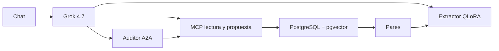

# Relevo

Agente de turnos para una pyme colombiana.
Consultar es autónomo. Escribir exige aprobación.

SI7016 · Universidad EAFIT · 2026-2
Isabel Jurado · Alejandro Silva · David Botero

### Notas del orador

Abran con el principio, no con la pila. Una frase: la coordinadora habla en coloquial y la nómina no cambia hasta que ella ve la fila. El resto de la charla cabe en doce minutos si la demo ya está caliente. Los números salen del informe, sección 1.

---

# El problema

Un chat genérico responde.
Cuando la tarea es **programar un turno**, responder no basta y escribir a ciegas no se puede.

Público: coordinación de turnos, no un perfil técnico.
Español coloquial: «la otra semana», «el puente», «la mañana».

### Notas del orador

Caso de la propuesta de la semana 1: clínica, restaurante o vigilancia con rotación. Nosotros fijamos una clínica ficticia. No prometan datos reales: empleados y órdenes son sintéticos, semilla 42.

---

# El principio

1. Consultar turnos, ausencias y norma: autónomo.
2. Escribir en la nómina: solo si una persona aprueba la tarjeta.
3. La tarjeta muestra exactamente las filas que se escriben.
4. La decisión queda como par de preferencia.

### Notas del orador

Repitan el 2 y el 3. Es el criterio con el que se defiende la funcionalidad. `ejecutar_propuesta` no es una tool del modelo. Si el auditor no contesta, la tarjeta dice «sin auditar» y el turno sigue.

---

# Demo

Ocho minutos. Guion: `informe/GUION_DEMO.md`.

1. Perfil de enfermería: quién cubre la noche del sábado.
2. Recargo nocturno, con el artículo a la vista.
3. Orden de Doris. La tarjeta trae veredicto.
4. Se corrige el domingo y se aprueba.
5. La fila `origen = 'tarjeta'` y el par.
6. La traza en Phoenix.

### Notas del orador

No pulsen el ejemplo «Ana»: Ana es de recepción y este perfil debe rechazarla. Doris Herrera Sánchez es de enfermería y el nombre es único. Si no hay clave de xAI, pasen al plan B del guion: no improvisen una respuesta.

---

# Arquitectura

El asistente conversa. El auditor no.
MCP habla con los datos. A2A habla entre agentes.

### Notas del orador

Figura completa en `informe/figuras/componentes.md` y en el informe §4. Tres equipos: enfermería 20, recepción 10, vigilancia 10. Gerencia ve los tres. Un coordinador no propone fuera de su equipo.

---

# MCP y A2A

**MCP.** Tools con contrato Zod. Lectura con `readOnlyHint`. `ejecutar_propuesta` no está expuesta al modelo.

**A2A.** JSON-RPC `message/send`, sin SDK. Agent Card en `/.well-known/agent.json`.

Domingo 4 de octubre, empleado activo, turno de mañana:

`veredicto: observaciones`
«El 2026-10-04 es domingo: aplica recargo dominical.»
Norma: CST art. 179, chunk 193, fuente `cst_pr006`.

### Notas del orador

Es el mensaje literal del reporte D2, no un ejemplo reconstruido. Errores JSON-RPC en español, del `-32700` al `-32001`. El auditor lee con `relevo_lector`. El informe §5.7 trae el request y el response enteros por si piden el frame.

---

# RAG con citas

«Recargo nocturno», modo híbrido, 322 ms, re-ranker no cargado (HTTP 501).

| Orden | Artículo | Para qué sirve |
|---:|---|---|
| 1 | art. 169 | Base del recargo |
| 2 | art. 168 | 35 % sobre el diurno |
| 3 | art. 161 | Jornada y nocturno |

La UI numera Fuentes con enlace al Senado.

### Notas del orador

Fuente: reporte C1 para el humo, reporte F1 para las 20 preguntas. En léxico puro (reporte B2) «recargo nocturno» abría por el art. 161, y «trabajo nocturno porcentaje» no devolvía nada. Digan esa diferencia. F1, modo híbrido, 20 de 20: recall@3 97,50 %, recall@5 100 %, recall@8 100 %, MRR 0,933. El juez de fidelidad (Grok 4.7, `evaluacion/citas.md`): media 0,926; 16 de 20 preguntas en 1,000; las más bajas son c02 (0,500), c03 (0,600), c04 (0,667) y c12 (0,750), y en esas el artículo ya estaba en el top 3. El juez es el mismo modelo del asistente: díganlo. El reporte F1 no trae la corrida léxica de esas 20 preguntas.

---

# Tarjeta y auditor

La orden se extrae, se valida y se guarda `pendiente`.
El auditor contesta antes de que aparezca la tarjeta.

| Veredicto | Cuándo | Qué puede hacer la persona |
|---|---|---|
| rechazado | Empleado inválido o solape duro | Corregir o rechazar. Aprobar va deshabilitado |
| observaciones | Domingo, festivo, noche, más de 6 días o más de 44 h | Decidir informada |
| aprobado | Todo pasa | Aprobar |

10 escenarios del reporte D2 cayeron en la clase que el caso buscaba.

### Notas del orador

El tope es 44 h (Ley 2101, desde julio de 2026), aunque el art. 161 indexado hable de 42 h tras la Ley 2466. Díganlo antes de que lo pregunten. F1: 20/20, precisión 100 % en aprobado (3), observaciones (9) y rechazado (8). La matriz es diagonal. Las 10 trampas nuevas están en el informe §8.3. Es cumplimiento de las reglas, no un rotulado humano independiente.

---

# Extractor afinado

Qwen3.5-0.8B, QLoRA 4-bit, test congelado n = 65.

| | Base | LoRA v1 |
|---|---:|---:|
| Exactitud total | 3,08 % | 76,92 % |
| Fechas (F1) | 19,18 % | 84,62 % |
| Acción | 55,38 % | 84,62 % |

Gana en todos los campos frente al base. En v1, la acción sigue siendo el peor campo (84,62 %).

### Notas del orador

Fuente: reporte C3. El 3 % y el 77 % de la spec son ese 3,08 y ese 76,92, redondeados. C3 compara contra el base. La comparación contra Grok 4.7 (98,46 %) está en la diapositiva del ciclo DPO y en Evaluación. Pico de VRAM 2 871 MiB en una 4060 de 8 GB. El error que queda en C3: «no le deje turno el 12 de octubre» salió como ausencia y con otra fecha. v2 sube la acción a 96,92 %; el detalle y el intervalo están en la diapositiva de DPO.

---

# Ciclo DPO

Tarjeta → decisión → `pares_preferencia` → DPO sobre v1 → mismo test.

Hoy, en la base local, sin re-sembrar:

- 120 decisiones, todas del `simulador`
- 91 aprobaciones limpias, 29 correcciones, 29 pares DPO
- 0 decisiones de una persona
- Exactitud total: 76,92 % → 83,08 % (+6,15 pp)
- IC 95 %: v1 [66,15 %, 87,69 %], v2 [73,85 %, 90,77 %]
- Grok 4.7 en el mismo test: 98,46 % [95,38 %, 100,00 %]. No se solapa con v2

### Notas del orador

Fuente: reporte E2. La pregunta de la propuesta: ¿un modelo pequeño, afinado con las correcciones de sus usuarios, puede superar al de frontera en esta tarea, sin sacar los datos de la organización? Hoy supera a su base y el DPO suma 6,15 puntos sobre v1, con intervalos que se solapan. Frente a Grok 4.7 no: 98,46 % contra 83,08 %, intervalos que no se solapan (`evaluacion/extraccion.md`). La brecha restante es sobre todo de fechas (F1 84,62 % contra 98,46 %). Las 91 aprobaciones no son pares DPO: `rechazada` va null. La señal útil son las 29 correcciones, y son simuladas. El DPO corrigió la acción `quitar` (50 % → 90 %), no el calendario. Loss 0,693 → 0,586, `rewards/accuracies` 0,6875, 206,434 s, pico 8 428,99 MiB. El modelo pequeño solo es viable por costo y privacidad con más correcciones, y la tarjeta hace barato acumularlas. No exageren en ninguna dirección: no alcanza a la frontera hoy, y no se midió cuánto subiría con más pares.

---

# Observabilidad

OpenTelemetry → Phoenix, puerto 6006, protobuf.
JSON OTLP recibe HTTP 415 en esta imagen.

El turno de evidencia, sin modelo, dejó el span `relevo.turno`, kind AGENT, status OK.

Guardrails: 400 si el mensaje va vacío o pasa de 2 000 caracteres, 429 a las 30 peticiones por minuto, y una advertencia si la norma no se cita.

### Notas del orador

Fuente: reporte E1. Si Phoenix está caído el chat sigue y no escupe el error en cada request. En la demo abran la traza del turno que acaban de hacer, no la captura vieja, salvo que el export falle.

---

# Evaluación

| Métrica | Qué hay hoy | Qué falta |
|---|---|---|
| Extracción | 3,08 % → 76,92 % → 83,08 %, n = 65. IC de v2 [73,85 %, 90,77 %]. Grok 4.7: 98,46 % [95,38 %, 100,00 %] | Más correcciones de personas |
| Citas | Híbrido: recall@3 97,50 %, @5 y @8 100 %, MRR 0,933. Fidelidad del juez (Grok 4.7): 0,926 | Juez independiente del asistente |
| Auditor | 20/20. Precisión 100 %. Matriz diagonal | Rotulado humano independiente |
| Aprobación | Simulador 75,83 % (91/120). Humanos: 0 | Sesiones |

Pruebas con usuarios: protocolo escrito, sesiones pendientes.

### Notas del orador

No conviertan 91/120 en «le atinamos al 76 % de los usuarios». Es el simulador contra la etiqueta del generador: 75,83 %. Informe §8. Los intervalos de v1 y v2 se solapan; los de v2 y Grok 4.7 no. Fuentes: `evaluacion/extraccion.md` y `evaluacion/citas.md`. El protocolo está en `evaluacion/PROTOCOLO_USUARIOS.md`.

---

# Qué no afirmamos

- No hay cartillas del Ministerio: los URL oficiales no respondieron.
- No hay voz ni despliegue en Vercel.
- En Windows el QLoRA corrió sin los kernels lineales. Tardó 4 635 s. Los pesos no están en el repo.
- «Elizabeth» y «Diego» son dos personas. «Ana» no es de enfermería.
- «De hoy en ocho» está en +7 en el dataset y en +8 en el prompt de Grok. El guion no usa esa frase.

### Notas del orador

Esta diapositiva es la de las preguntas incómodas. Mejor decirlas ustedes. Informe §10.

---

# Cierre

Hay un camino de la orden coloquial a una fila con `origen = 'tarjeta'`, con un veredicto que se lee antes de aprobar.

El extractor pequeño aprende la tarea: 3,08 % → 76,92 % → 83,08 % contra su base. Los intervalos de v1 y v2 se solapan.

Contra Grok 4.7 todavía no llega (83,08 % frente a 98,46 %), y faltan las sesiones con personas que den más señal de corrección.

### Notas del orador

Cierren con la brecha medida (unos 15 pp, sobre todo fechas) y con las sesiones que faltan, y paren. El delta de DPO ya está dicho: corrigió la acción, no las fechas. El informe, la presentación y el guion están en `informe/`. Licencia MIT.

---

# Gracias

Isabel Jurado Jaramillo
Alejandro Silva Zuluaga
David Botero Londoño

Código sintético, corpus público, licencia MIT.

### Notas del orador

Si piden reproducir: `README.md`, anexo B del informe. Gates: `npm run lint`, `npm test`, `npm run build`. Python 3.11 para el venv de gates.
